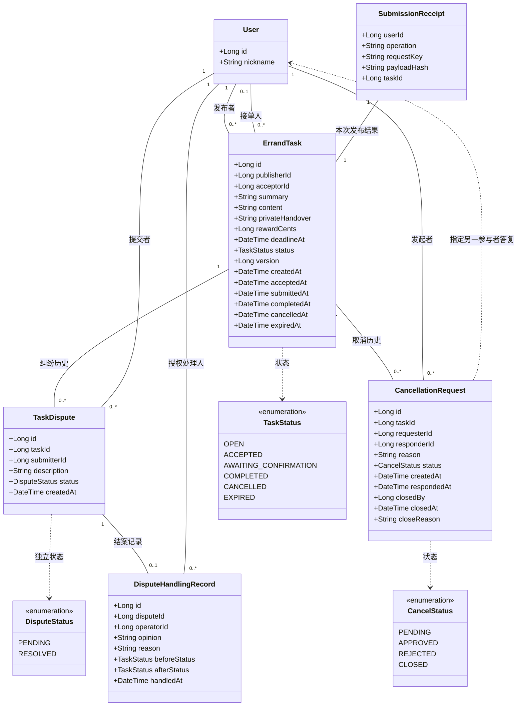

# C 1.1 跑腿任务核心类图

> 图例 01/13；独立单图评审。
> 覆盖：故事32—36、25；FR-31—35、NFR-04（实体关系）。

## 设计前提（待组内确认）

| 编号 | 暂采用的口径 | 依据与影响 |
| --- | --- | --- |
| C1 | 主链路为 `OPEN → ACCEPTED → AWAITING_CONFIRMATION → COMPLETED`；另有 `CANCELLED / EXPIRED` | 对应 SRS 附录 B；`EXPIRED` 是本设计补充，须评审，不将草稿作为已发布任务持久化 |
| C3 | 报酬使用正数、最多两位小数的金额，存储为整数分 `rewardCents`；上限待确认 | 本期仅记录信息，不接入支付、退款、赔付、余额或担保 |
| C4 | 每个任务最多一条待处理取消申请；提出申请不改变任务状态；申请待处理期间暂停提交完成与确认完成 | 防止同意取消与完成互相覆盖；拒绝后解除暂停。撤回、超时自动同意不在本初稿流程中 |
| C5 | 纠纷状态与任务状态分开；提交纠纷只建立 `PENDING` 记录，不自动冻结或改变任务状态 | 同一任务最多一条待处理纠纷；已接单及有接单人的历史终态均可反馈；受理时限待确认 |
| C6 | 管理员默认可仅保存处理意见；必要状态调整暂允许 `ACCEPTED / AWAITING_CONFIRMATION → CANCELLED` 或 `AWAITING_CONFIRMATION → COMPLETED` | 不允许恢复终态、改换接单人或直接将未提交完成的任务认定完成；调整须有独立权限、理由及审计，具体范围待确认 |
| C9 | 登录、用户和管理授权复用 A 及共享权限能力；C 校验任务参与关系和宠物归属 | 未登录 401，管理权限不足 403；本人专属资源不存在或无权读取时返回 404；越权不返回私人字段 |
| C11 | 跑腿发布使用 `(userId, operation, requestKey)` 唯一键和请求摘要；相同键及相同内容返回原结果，不同内容返回冲突 | 覆盖故事25 / NFR-04，与 B 统一协议；幂等记录与任务同事务保存，保留期及重试窗口待确认 |

编号沿用完整初稿。正文中的章节号对应原设计初稿；完整跨模块约定及需求覆盖表在第13个PR汇总。

## 图与 Mermaid 源码

要点：

- `User` 由 A 维护，仅引用必要字段；`acceptorId` 在接单前为空，接单后必须存在且不同于 `publisherId`。已取消任务保留参与者，不删除历史关联。
- 任务、取消申请和纠纷各自有状态，不能将“已申请取消”或“存在纠纷”写进任务主状态来替换业务进度。
- 数据库约束：每任务最多一条 `PENDING` 取消申请、最多一条 `PENDING` 纠纷；技术栈确定后采用条件唯一索引或等效约束，并统一锁定任务行串行化创建与状态变更。
- `DisputeHandlingRecord` 保存业务意见、状态前后值和调整理由，只追加，不向执行者提供修改或删除入口；共享 `AdminAuditLog` 另外保存管理审计，不用它替代业务意见。
- `SubmissionReceipt` 是 C 侧逻辑模型，若 B 提供共享幂等组件则复用，不再建设第二份幂等存储。成功发布的回执与任务一一关联，创建失败不留下成功回执。
