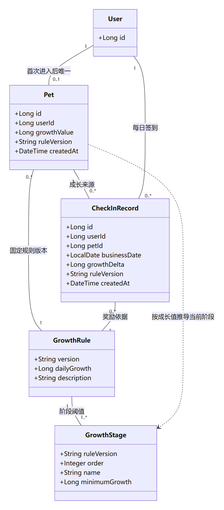
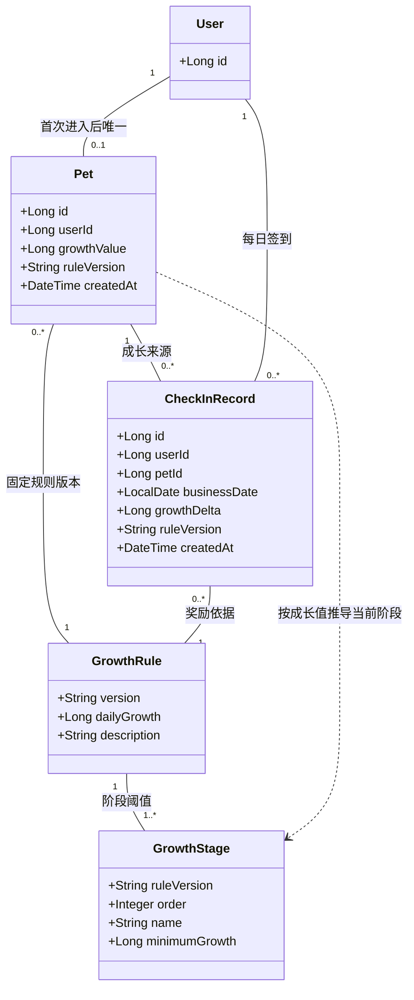

# C 1.2 宠物与签到类图

> 图例 02/13；独立单图评审。
> 覆盖：故事10、22、24；FR-36、FR-37、NFR-03（实体关系）。

## 设计前提（待组内确认）

| 编号 | 暂采用的口径 | 依据与影响 |
| --- | --- | --- |
| C7 | 每用户最多一个宠物；初始成长值为 0；签到奖励、阶段名称及阈值以版本化成长规则配置 | 不虚构正式奖励数值；规则阈值从 0 起严格递增，阶段由成长值计算；规则变更不回算既有签到奖励 |
| C8 | 签到日期由服务端按 `Asia/Shanghai` 自然日确定，在请求进入业务服务时固定；不接受客户端日期和补签 | 跨零点重试按新请求日期处理；事务重试沿用本次已确定日期，日期口径须与前端提示一致 |

编号沿用完整初稿。正文中的章节号对应原设计初稿；完整跨模块约定及需求覆盖表在第13个PR汇总。

## 图与 Mermaid 源码

要点：

- `Pet.userId` 唯一；用户未进入宠物页时可没有宠物，首次初始化成功后为一对一，不提供删除后重建来重复领奖。
- `CheckInRecord(userId, businessDate)` 唯一；`petId`、`userId` 须对应同一归属，可用组合外键或等效数据库约束保证。
- 阶段不额外保存一份可独立修改的数据：选择同规则版本中 `minimumGrowth <= growthValue` 的最大阈值阶段。响应同时返回规则版本、成长值、当前阶段及规则说明。
- 成长规则版本一经用于宠物或签到即保持不可变；规则升级、宠物迁移由全组另定方案。本期只通过签到增加成长值，因此应满足 `growthValue = SUM(growthDelta)`，初始值为 0。
