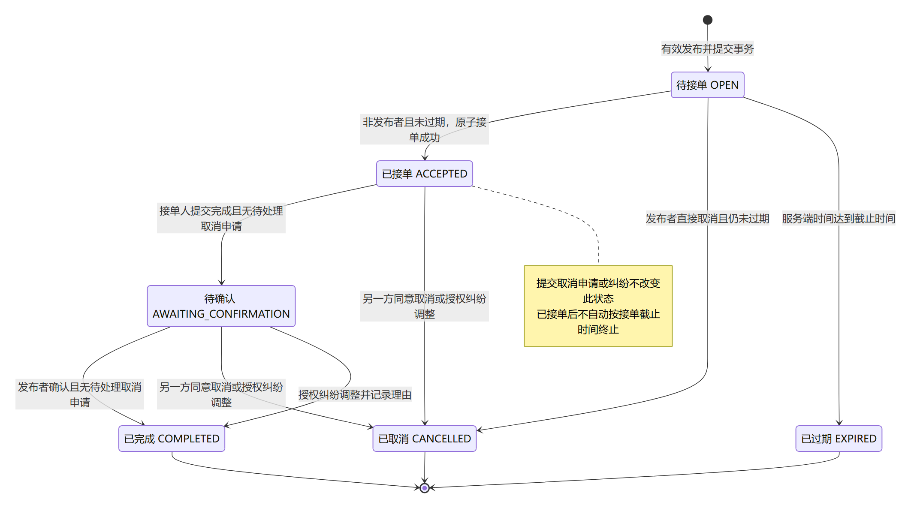
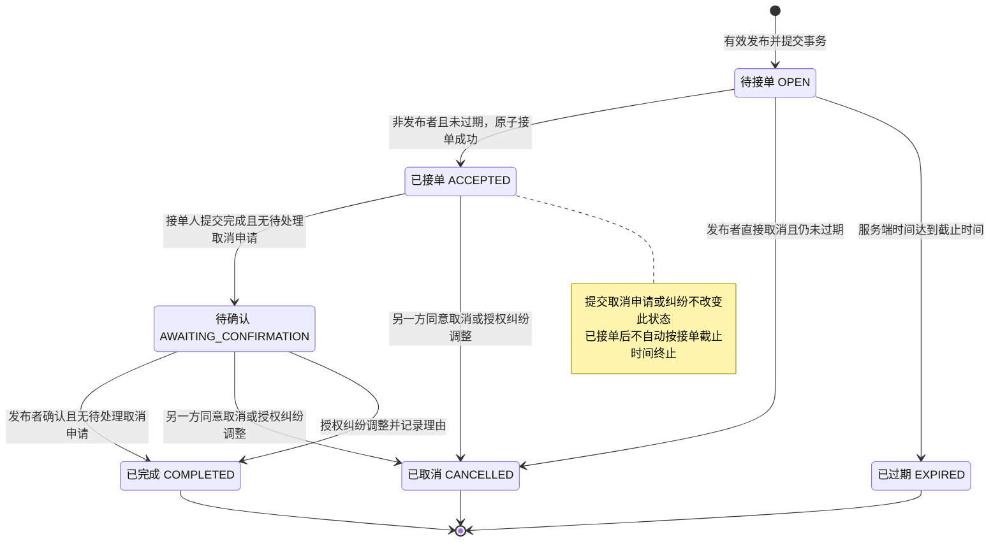

# C 2.1 跑腿任务生命周期

> 图例 03/13；独立单图评审。
> 覆盖：故事21、32—36；FR-30—35（任务状态）。

## 设计前提（待组内确认）

| 编号 | 暂采用的口径 | 依据与影响 |
| --- | --- | --- |
| C1 | 主链路为 `OPEN → ACCEPTED → AWAITING_CONFIRMATION → COMPLETED`；另有 `CANCELLED / EXPIRED` | 对应 SRS 附录 B；`EXPIRED` 是本设计补充，须评审，不将草稿作为已发布任务持久化 |
| C2 | `deadlineAt` 暂作接单截止时间；仅未接单任务到期变为 `EXPIRED`；已接单任务不自动取消 | SRS 明确过期不可接取，但未明确接单后超时规则；后续调整须同步 §2.1 / §3.3 |
| C4 | 每个任务最多一条待处理取消申请；提出申请不改变任务状态；申请待处理期间暂停提交完成与确认完成 | 防止同意取消与完成互相覆盖；拒绝后解除暂停。撤回、超时自动同意不在本初稿流程中 |
| C5 | 纠纷状态与任务状态分开；提交纠纷只建立 `PENDING` 记录，不自动冻结或改变任务状态 | 同一任务最多一条待处理纠纷；已接单及有接单人的历史终态均可反馈；受理时限待确认 |
| C6 | 管理员默认可仅保存处理意见；必要状态调整暂允许 `ACCEPTED / AWAITING_CONFIRMATION → CANCELLED` 或 `AWAITING_CONFIRMATION → COMPLETED` | 不允许恢复终态、改换接单人或直接将未提交完成的任务认定完成；调整须有独立权限、理由及审计，具体范围待确认 |

编号沿用完整初稿。正文中的章节号对应原设计初稿；完整跨模块约定及需求覆盖表在第13个PR汇总。

## 图与 Mermaid 源码

要点：

- 到期判断使用服务端数据库时间，边界为 `now >= deadlineAt`；接单原子更新必须包含 `deadlineAt > now`，不能只依赖定时任务。
- 查询时可计算有效 `EXPIRED` 状态，定时任务仅将仍为 `OPEN` 的到期任务持久化为 `EXPIRED`，避免页面误示待接单；本人历史列表保留过期记录。
- 接单、直接取消、到期处理竞争同一任务行；同意取消、提交完成、确认完成及管理员调整也遵循同一行锁 / 版本校验协议，每次变更递增 `version`。
- `COMPLETED / CANCELLED / EXPIRED` 为终态，不可再接单、提交完成、确认完成或通过管理员恢复。终态纠纷仍可保存意见。
