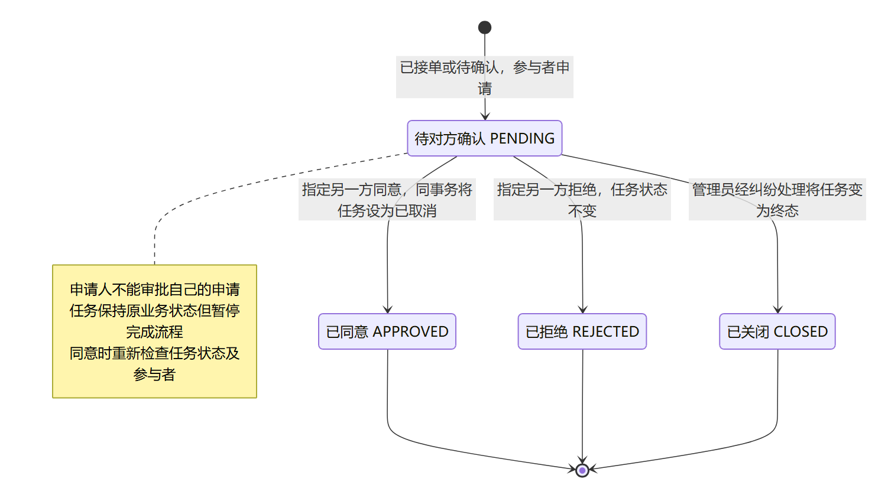
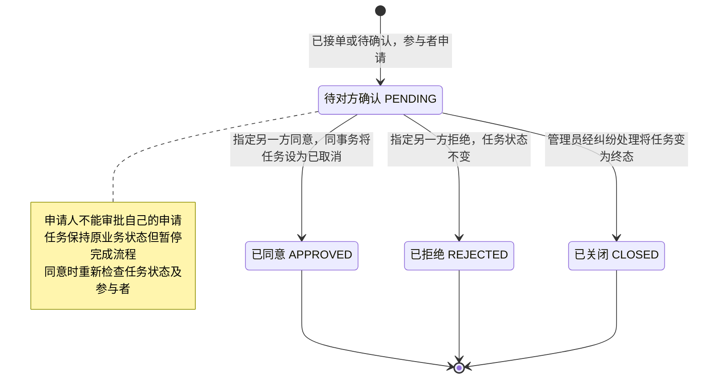

# C 2.2 取消申请生命周期

> 图例 04/13；独立单图评审。
> 覆盖：故事35；FR-34（取消申请状态）。

## 设计前提（待组内确认）

| 编号 | 暂采用的口径 | 依据与影响 |
| --- | --- | --- |
| C4 | 每个任务最多一条待处理取消申请；提出申请不改变任务状态；申请待处理期间暂停提交完成与确认完成 | 防止同意取消与完成互相覆盖；拒绝后解除暂停。撤回、超时自动同意不在本初稿流程中 |
| C6 | 管理员默认可仅保存处理意见；必要状态调整暂允许 `ACCEPTED / AWAITING_CONFIRMATION → CANCELLED` 或 `AWAITING_CONFIRMATION → COMPLETED` | 不允许恢复终态、改换接单人或直接将未提交完成的任务认定完成；调整须有独立权限、理由及审计，具体范围待确认 |

编号沿用完整初稿。正文中的章节号对应原设计初稿；完整跨模块约定及需求覆盖表在第13个PR汇总。

## 图与 Mermaid 源码

要点：

- 待接单任务直接取消，不创建需要双方处理的申请。
- `APPROVED` 与任务 `CANCELLED` 同事务提交；`REJECTED` 不改变任务状态。拒绝后可新建申请，历史申请不复用、不删除。
- 同一待处理申请的重复提交返回已有记录；另一方再申请时提示先处理已有申请。重复答复返回既有结果，不能改写已生效的决定。
- `CLOSED` 用来保留因管理员调整而失效的申请，关闭理由及操作人必须保存；它不同于另一参与者拒绝。
