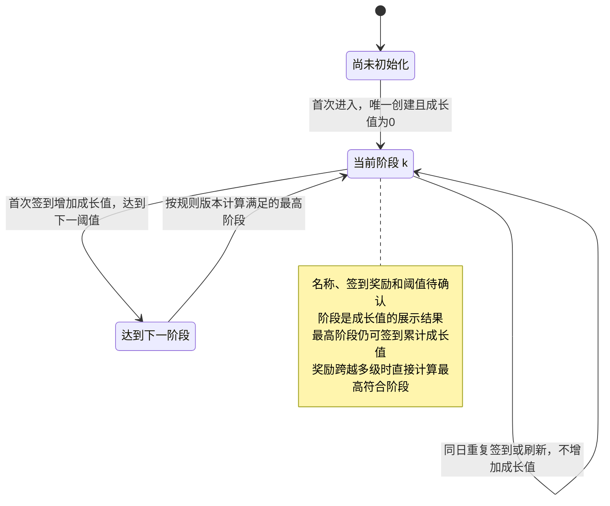

# C 2.3 宠物初始化与成长

> 图例 05/13；独立单图评审。
> 覆盖：故事10、22；FR-36、FR-37（初始化与成长状态）。

## 设计前提（待组内确认）

| 编号 | 暂采用的口径 | 依据与影响 |
| --- | --- | --- |
| C7 | 每用户最多一个宠物；初始成长值为 0；签到奖励、阶段名称及阈值以版本化成长规则配置 | 不虚构正式奖励数值；规则阈值从 0 起严格递增，阶段由成长值计算；规则变更不回算既有签到奖励 |
| C8 | 签到日期由服务端按 `Asia/Shanghai` 自然日确定，在请求进入业务服务时固定；不接受客户端日期和补签 | 跨零点重试按新请求日期处理；事务重试沿用本次已确定日期，日期口径须与前端提示一致 |

编号沿用完整初稿。正文中的章节号对应原设计初稿；完整跨模块约定及需求覆盖表在第13个PR汇总。

## 图与 Mermaid 源码

要点：本图说明业务成长过程，并不要求将“尚未初始化”或“达到下一阶段”存成数据库状态。成长值、规则版本与签到记录是持久化依据。
