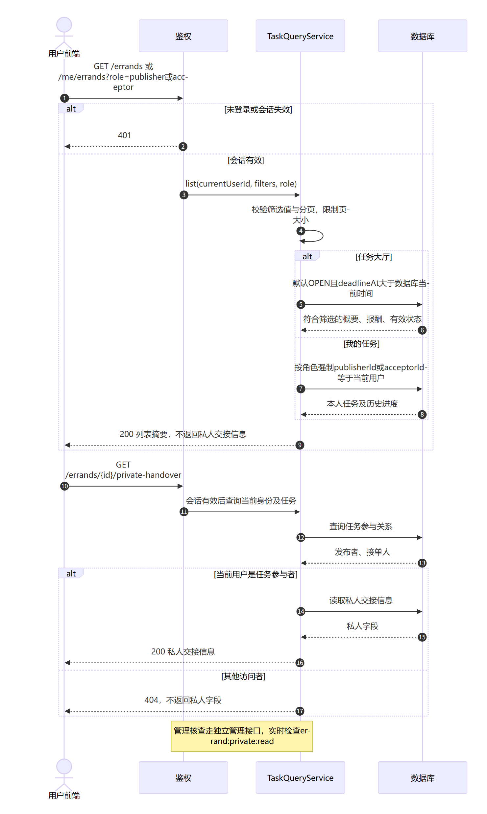
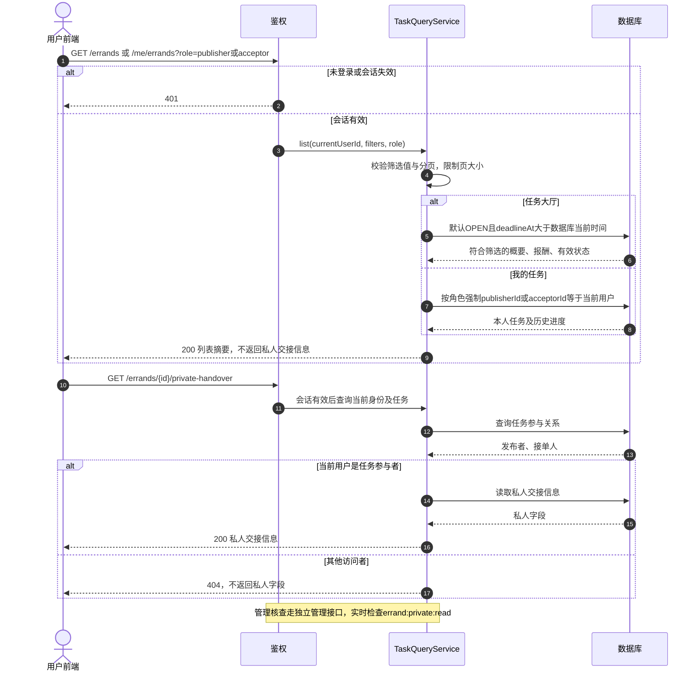

# C 3.1 浏览任务和查看本人任务（FR-30 / FR-33）

> 图例 06/13；独立单图评审。
> 覆盖：故事21、34；FR-30、FR-33（浏览、筛选、本人归属及私人信息）。

## 设计前提（待组内确认）

| 编号 | 暂采用的口径 | 依据与影响 |
| --- | --- | --- |
| C2 | `deadlineAt` 暂作接单截止时间；仅未接单任务到期变为 `EXPIRED`；已接单任务不自动取消 | SRS 明确过期不可接取，但未明确接单后超时规则；后续调整须同步 §2.1 / §3.3 |
| C9 | 登录、用户和管理授权复用 A 及共享权限能力；C 校验任务参与关系和宠物归属 | 未登录 401，管理权限不足 403；本人专属资源不存在或无权读取时返回 404；越权不返回私人字段 |

编号沿用完整初稿。正文中的章节号对应原设计初稿；完整跨模块约定及需求覆盖表在第13个PR汇总。

## 图与 Mermaid 源码

要点：

- 显式筛选可以查看历史状态，但过期任务始终不能接取；具体筛选项及排序字段待评审，初稿支持状态、报酬范围与分页，默认按发布时间倒序。
- `/me/errands` 不接收可覆盖会话身份的用户编号；一般详情只返回公开业务内容，私人交接字段使用独立 DTO 和独立查询，不能由前端隐藏来保护。
- 授权管理员通过 `GET /admin/errands/{id}/private-handover` 读取最小核查字段，校验 `errand:private:read`；无权限返回 403。具备一般管理员角色不等于拥有此权限，通知载荷也不携带私人信息。
