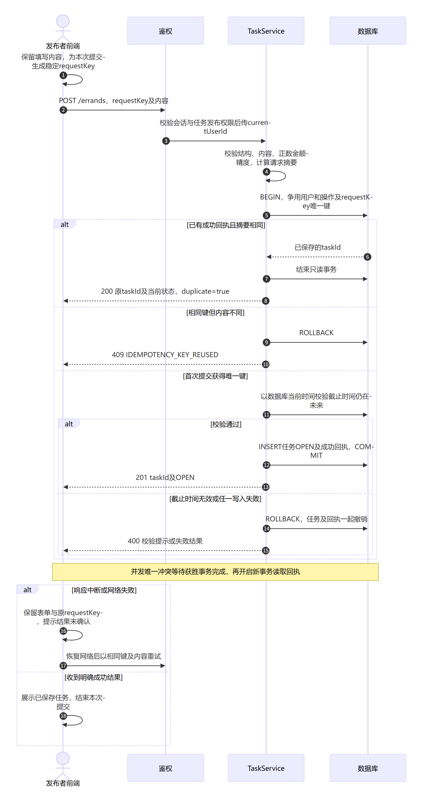
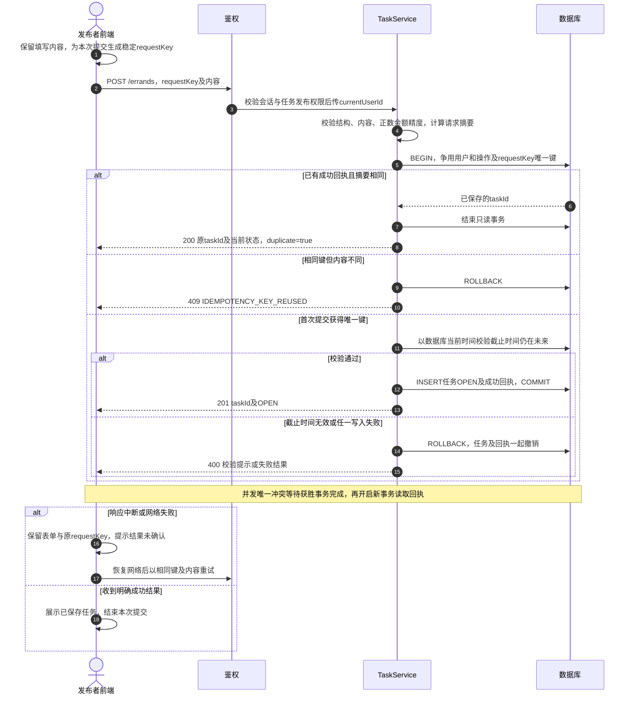

# C 3.2 发布任务（FR-31 / NFR-04）

> 图例 07/13；独立单图评审。
> 覆盖：故事32、25；FR-31、NFR-04（发布与安全重试）。

## 设计前提（待组内确认）

| 编号 | 暂采用的口径 | 依据与影响 |
| --- | --- | --- |
| C3 | 报酬使用正数、最多两位小数的金额，存储为整数分 `rewardCents`；上限待确认 | 本期仅记录信息，不接入支付、退款、赔付、余额或担保 |
| C9 | 登录、用户和管理授权复用 A 及共享权限能力；C 校验任务参与关系和宠物归属 | 未登录 401，管理权限不足 403；本人专属资源不存在或无权读取时返回 404；越权不返回私人字段 |
| C11 | 跑腿发布使用 `(userId, operation, requestKey)` 唯一键和请求摘要；相同键及相同内容返回原结果，不同内容返回冲突 | 覆盖故事25 / NFR-04，与 B 统一协议；幂等记录与任务同事务保存，保留期及重试窗口待确认 |

编号沿用完整初稿。正文中的章节号对应原设计初稿；完整跨模块约定及需求覆盖表在第13个PR汇总。

## 图与 Mermaid 源码

要点：

- 校验空白内容、长度、金额格式、截止时间；具体长度、金额上限待确认。请求中的 `publisherId`、初始状态和接单人不能由客户端指定。
- 幂等查询优先于针对“首次创建”的动态截止时间校验：已成功发布但响应丢失的请求，即使重试时截止时间已到，也能获得原任务结果，不新建任务。
- 未送达请求重试时若截止时间已过，返回明确校验失败并保留表单；成功持久化但响应中断时沿用原键取回结果。用户修改内容再提交时使用新键，不依靠按钮禁用保证去重。
- 数据库唯一冲突后须先回滚失败事务，再用新事务回查成功回执；获胜事务若回滚则允许重试争用，不把异常当作成功。
