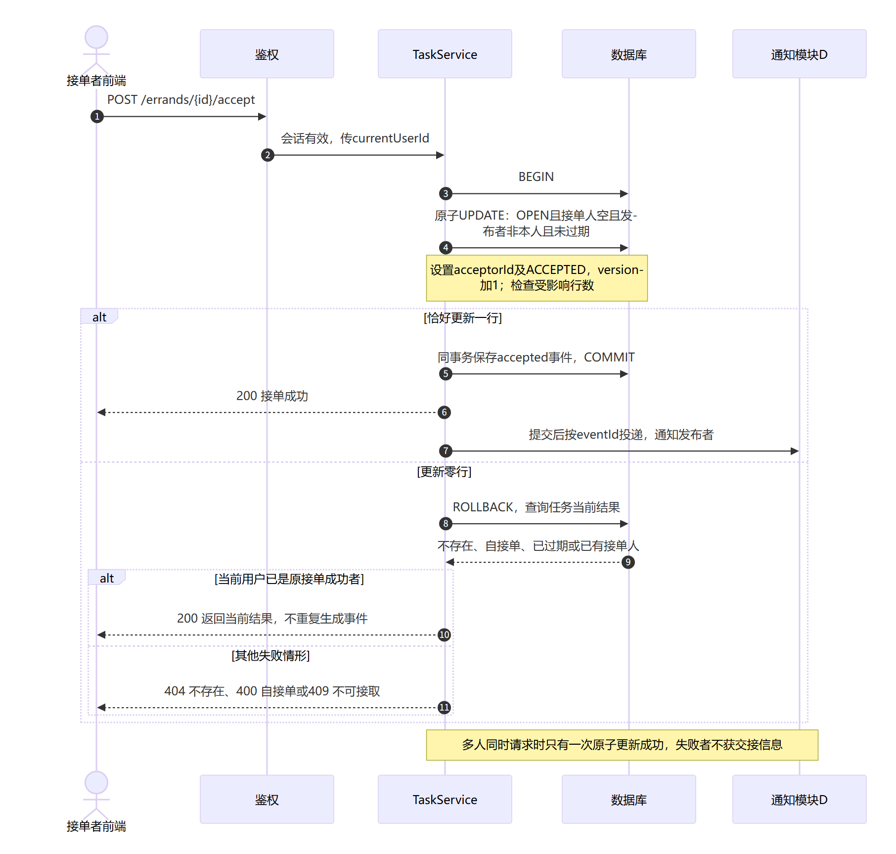
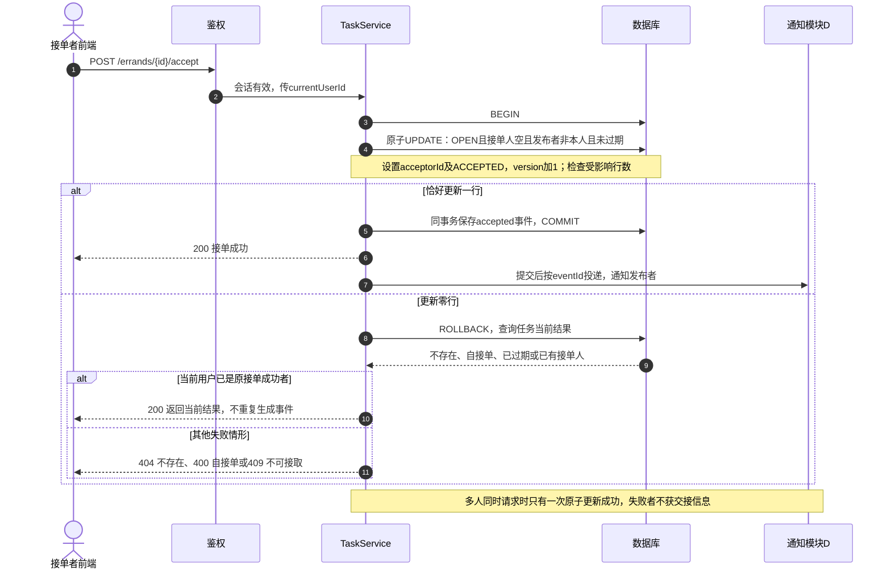

# C 3.3 接单（FR-32 / NFR-03）

> 图例 08/13；独立单图评审。
> 覆盖：故事33、24；FR-32、NFR-03（原子接单）。

## 设计前提（待组内确认）

| 编号 | 暂采用的口径 | 依据与影响 |
| --- | --- | --- |
| C1 | 主链路为 `OPEN → ACCEPTED → AWAITING_CONFIRMATION → COMPLETED`；另有 `CANCELLED / EXPIRED` | 对应 SRS 附录 B；`EXPIRED` 是本设计补充，须评审，不将草稿作为已发布任务持久化 |
| C2 | `deadlineAt` 暂作接单截止时间；仅未接单任务到期变为 `EXPIRED`；已接单任务不自动取消 | SRS 明确过期不可接取，但未明确接单后超时规则；后续调整须同步 §2.1 / §3.3 |
| C9 | 登录、用户和管理授权复用 A 及共享权限能力；C 校验任务参与关系和宠物归属 | 未登录 401，管理权限不足 403；本人专属资源不存在或无权读取时返回 404；越权不返回私人字段 |
| C10 | 业务记录与待投递事件同事务保存，提交后调用 D 的通知接口；投递失败可重试，接收端按事件号去重 | 以持久事件防止“已提交但通知丢失”；通知失败不回滚成功业务，最终可从业务页查询结果 |

编号沿用完整初稿。正文中的章节号对应原设计初稿；完整跨模块约定及需求覆盖表在第13个PR汇总。

## 图与 Mermaid 源码

要点：不使用“先查待接单、再无条件更新”的流程；到期、参与者和接单人条件必须进入同一原子更新。已接单者重试只返回已保存结果，即使任务后来进入终态，也不得表现成重新接单成功。
