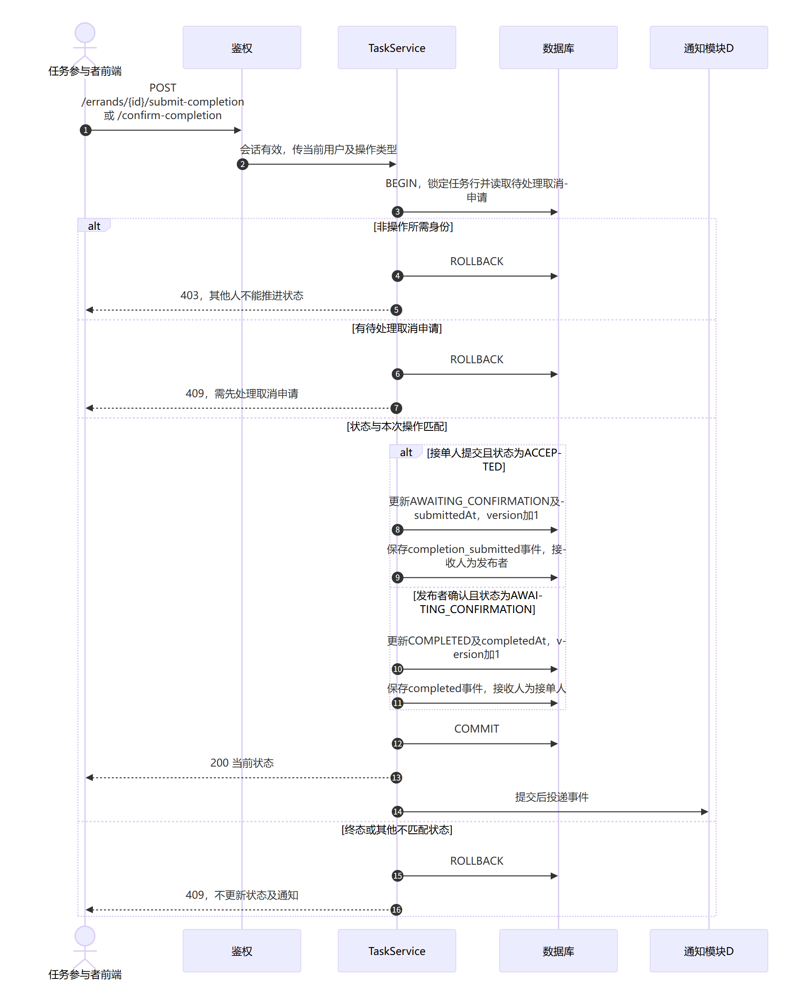
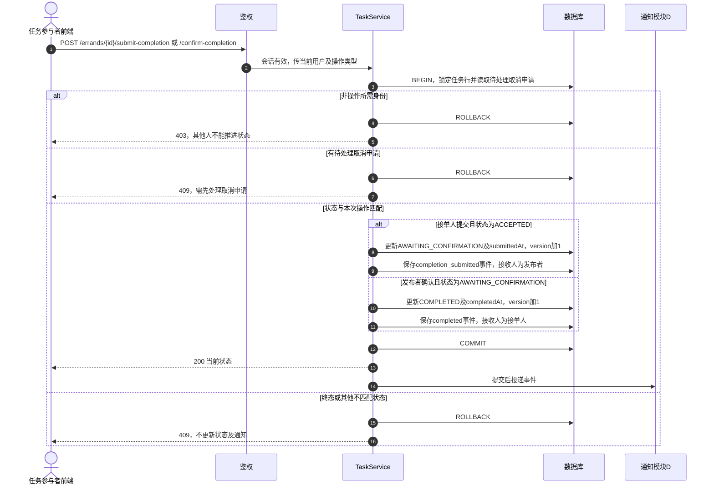

# C 3.4 提交完成与确认完成（FR-31 / FR-32）

> 图例 09/13；独立单图评审。
> 覆盖：故事32、33；FR-31、FR-32（提交完成与确认完成）。

## 设计前提（待组内确认）

| 编号 | 暂采用的口径 | 依据与影响 |
| --- | --- | --- |
| C1 | 主链路为 `OPEN → ACCEPTED → AWAITING_CONFIRMATION → COMPLETED`；另有 `CANCELLED / EXPIRED` | 对应 SRS 附录 B；`EXPIRED` 是本设计补充，须评审，不将草稿作为已发布任务持久化 |
| C4 | 每个任务最多一条待处理取消申请；提出申请不改变任务状态；申请待处理期间暂停提交完成与确认完成 | 防止同意取消与完成互相覆盖；拒绝后解除暂停。撤回、超时自动同意不在本初稿流程中 |
| C9 | 登录、用户和管理授权复用 A 及共享权限能力；C 校验任务参与关系和宠物归属 | 未登录 401，管理权限不足 403；本人专属资源不存在或无权读取时返回 404；越权不返回私人字段 |
| C10 | 业务记录与待投递事件同事务保存，提交后调用 D 的通知接口；投递失败可重试，接收端按事件号去重 | 以持久事件防止“已提交但通知丢失”；通知失败不回滚成功业务，最终可从业务页查询结果 |

编号沿用完整初稿。正文中的章节号对应原设计初稿；完整跨模块约定及需求覆盖表在第13个PR汇总。

## 图与 Mermaid 源码

要点：角色来自服务端任务记录，不采信请求中的角色。终态重复请求返回当前状态及冲突提示，不再推进状态；完成与取消共用任务锁，不能分别检查后并行覆盖。
