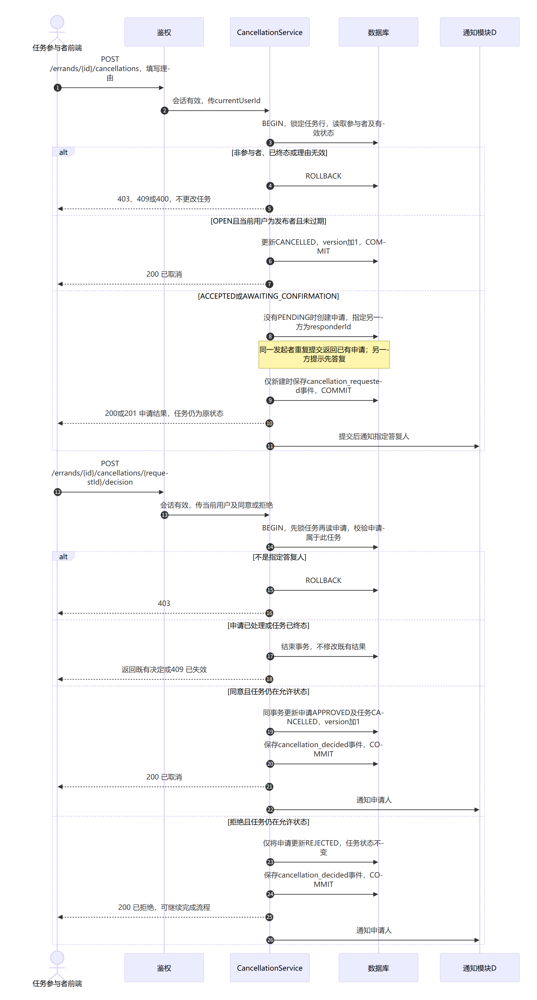
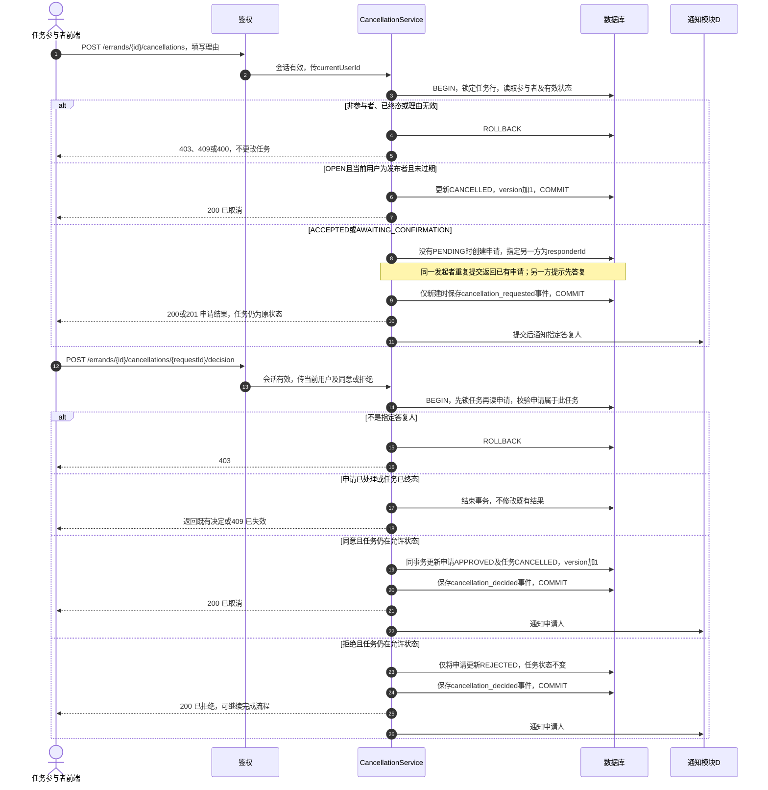

# C 3.5 取消任务（FR-34）

> 图例 10/13；独立单图评审。
> 覆盖：故事35；FR-34（取消申请与另一方答复）。

## 设计前提（待组内确认）

| 编号 | 暂采用的口径 | 依据与影响 |
| --- | --- | --- |
| C4 | 每个任务最多一条待处理取消申请；提出申请不改变任务状态；申请待处理期间暂停提交完成与确认完成 | 防止同意取消与完成互相覆盖；拒绝后解除暂停。撤回、超时自动同意不在本初稿流程中 |
| C6 | 管理员默认可仅保存处理意见；必要状态调整暂允许 `ACCEPTED / AWAITING_CONFIRMATION → CANCELLED` 或 `AWAITING_CONFIRMATION → COMPLETED` | 不允许恢复终态、改换接单人或直接将未提交完成的任务认定完成；调整须有独立权限、理由及审计，具体范围待确认 |
| C9 | 登录、用户和管理授权复用 A 及共享权限能力；C 校验任务参与关系和宠物归属 | 未登录 401，管理权限不足 403；本人专属资源不存在或无权读取时返回 404；越权不返回私人字段 |
| C10 | 业务记录与待投递事件同事务保存，提交后调用 D 的通知接口；投递失败可重试，接收端按事件号去重 | 以持久事件防止“已提交但通知丢失”；通知失败不回滚成功业务，最终可从业务页查询结果 |

编号沿用完整初稿。正文中的章节号对应原设计初稿；完整跨模块约定及需求覆盖表在第13个PR汇总。

## 图与 Mermaid 源码

要点：申请创建、答复、完成及管理员调整都先锁任务行，再锁申请，固定锁顺序。已到期但尚未落库的 `OPEN` 视作 `EXPIRED`，不能通过直接取消改写到期结果。取消成功后所有接单与完成入口都校验终态。
