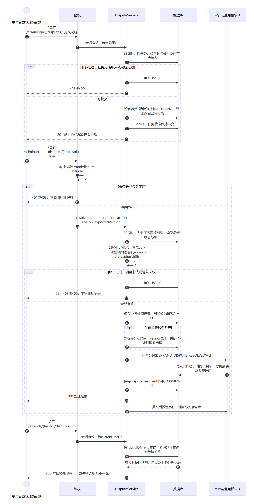
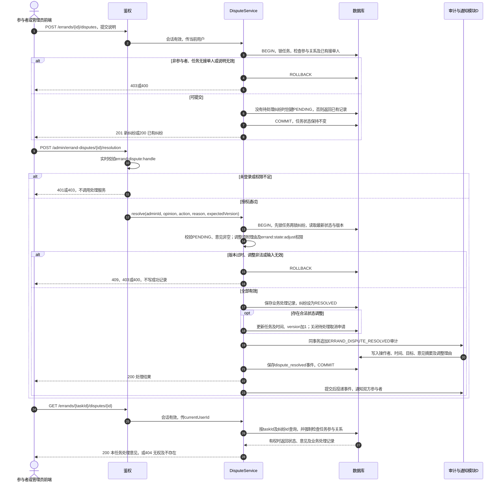

# C 3.6 反馈、处理和查看纠纷（FR-35）

> 图例 11/13；独立单图评审。
> 覆盖：故事36；FR-35，交叉NFR-02、NFR-06（纠纷与授权处理）。

## 设计前提（待组内确认）

| 编号 | 暂采用的口径 | 依据与影响 |
| --- | --- | --- |
| C5 | 纠纷状态与任务状态分开；提交纠纷只建立 `PENDING` 记录，不自动冻结或改变任务状态 | 同一任务最多一条待处理纠纷；已接单及有接单人的历史终态均可反馈；受理时限待确认 |
| C6 | 管理员默认可仅保存处理意见；必要状态调整暂允许 `ACCEPTED / AWAITING_CONFIRMATION → CANCELLED` 或 `AWAITING_CONFIRMATION → COMPLETED` | 不允许恢复终态、改换接单人或直接将未提交完成的任务认定完成；调整须有独立权限、理由及审计，具体范围待确认 |
| C9 | 登录、用户和管理授权复用 A 及共享权限能力；C 校验任务参与关系和宠物归属 | 未登录 401，管理权限不足 403；本人专属资源不存在或无权读取时返回 404；越权不返回私人字段 |
| C10 | 业务记录与待投递事件同事务保存，提交后调用 D 的通知接口；投递失败可重试，接收端按事件号去重 | 以持久事件防止“已提交但通知丢失”；通知失败不回滚成功业务，最终可从业务页查询结果 |

编号沿用完整初稿。正文中的章节号对应原设计初稿；完整跨模块约定及需求覆盖表在第13个PR汇总。

## 图与 Mermaid 源码

要点：

- 纠纷业务由 C 负责，不因涉及管理员而移交给 D；管理核查列表与详情使用 `/admin/errand-disputes` 及 `/{id}`，均校验 `errand:dispute:handle`。私人交接信息需额外校验 `errand:private:read`。
- 默认 `action=NONE` 只保存意见。状态调整按 C6 的有限转换白名单检查最新版本，理由必填；管理员仅提交意见时不得意外覆盖任务进度。
- 调整至 `COMPLETED` 要保存 `completedAt`；任何调整到终态同时将待处理取消申请设为 `CLOSED` 并记录关闭人、时间、理由。已终态任务只允许保存意见。
- 业务处理记录、纠纷结案、必要的任务调整、共享审计及待投递事件须一起提交，任一写入失败全部回滚。同一纠纷只能结案一次；重复处理返回既有结果或冲突，不再写审计和事件。
- 审计理由始终非空：未调整任务时使用处理意见作为结案理由；调整任务时使用单独填写的调整理由。业务记录保留完整意见，审计仅保存必要摘要。
- 上图暂按模块共用数据库且审计接口支持传递当前事务设计。若 D 使用独立存储，必须另行确认可靠审计提交方案，不能声称跨存储调用天然具有同一事务。
- 参与者只能看到本任务的意见和处置结果，不能直接访问 D 的管理审计查询接口。不执行任何资金操作。
