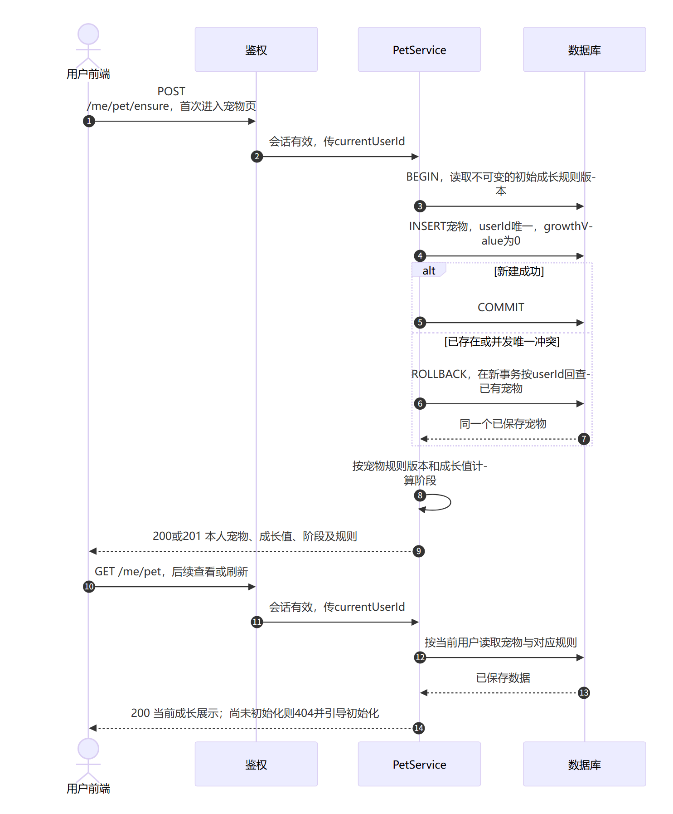
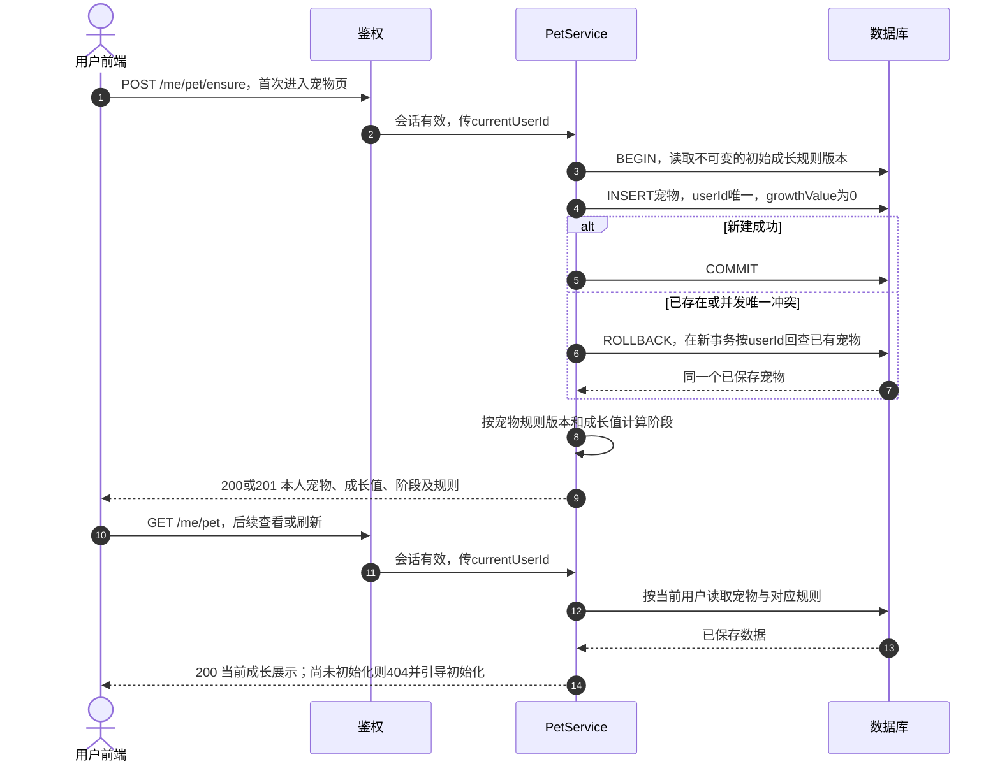

# C 3.7 首次进入与查看宠物（FR-36）

> 图例 12/13；独立单图评审。
> 覆盖：故事22、24；FR-36、NFR-03（唯一初始化）。

## 设计前提（待组内确认）

| 编号 | 暂采用的口径 | 依据与影响 |
| --- | --- | --- |
| C7 | 每用户最多一个宠物；初始成长值为 0；签到奖励、阶段名称及阈值以版本化成长规则配置 | 不虚构正式奖励数值；规则阈值从 0 起严格递增，阶段由成长值计算；规则变更不回算既有签到奖励 |
| C9 | 登录、用户和管理授权复用 A 及共享权限能力；C 校验任务参与关系和宠物归属 | 未登录 401，管理权限不足 403；本人专属资源不存在或无权读取时返回 404；越权不返回私人字段 |

编号沿用完整初稿。正文中的章节号对应原设计初稿；完整跨模块约定及需求覆盖表在第13个PR汇总。

## 图与 Mermaid 源码

要点：使用单独的初始化命令承接“首次进入自动创建”，普通 GET 只读。并发冲突回查须在失败事务回滚后执行，读到的是获胜事务提交的同一宠物；若获胜事务失败，则重试初始化，不返回虚构数据。
