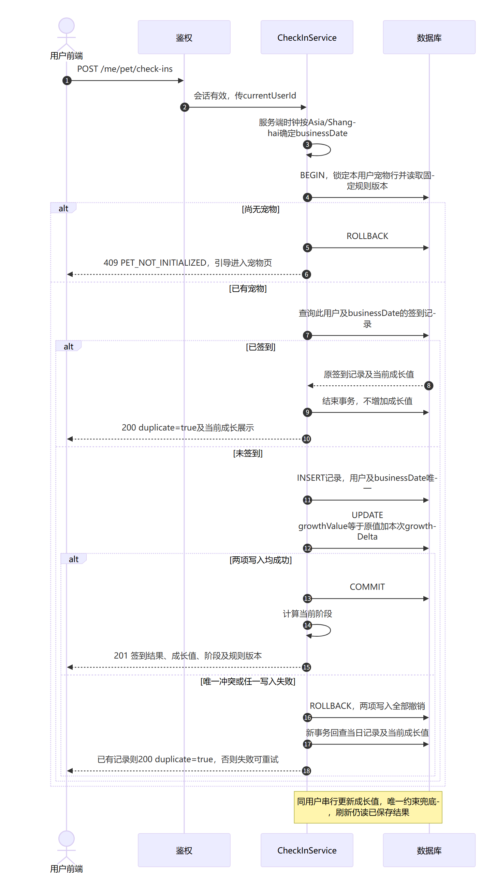
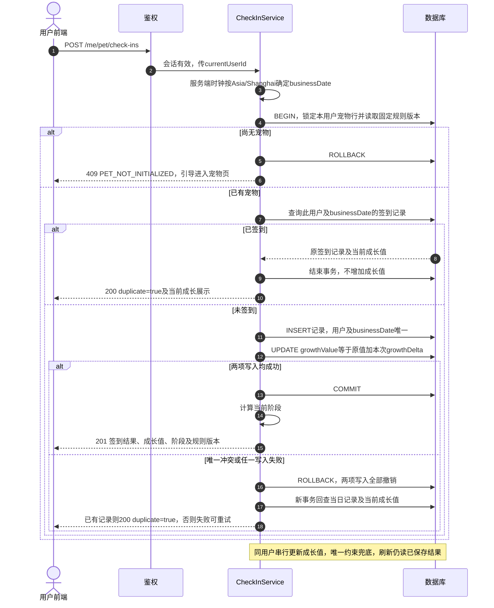

# C 3.8 每日签到（FR-37 / NFR-03）

> 图例 13/13；独立单图评审。
> 覆盖：故事10、24；FR-37、NFR-03（北京时间每日签到）。

## 设计前提（待组内确认）

| 编号 | 暂采用的口径 | 依据与影响 |
| --- | --- | --- |
| C7 | 每用户最多一个宠物；初始成长值为 0；签到奖励、阶段名称及阈值以版本化成长规则配置 | 不虚构正式奖励数值；规则阈值从 0 起严格递增，阶段由成长值计算；规则变更不回算既有签到奖励 |
| C8 | 签到日期由服务端按 `Asia/Shanghai` 自然日确定，在请求进入业务服务时固定；不接受客户端日期和补签 | 跨零点重试按新请求日期处理；事务重试沿用本次已确定日期，日期口径须与前端提示一致 |
| C9 | 登录、用户和管理授权复用 A 及共享权限能力；C 校验任务参与关系和宠物归属 | 未登录 401，管理权限不足 403；本人专属资源不存在或无权读取时返回 404；越权不返回私人字段 |

编号沿用完整初稿。正文中的章节号对应原设计初稿；完整跨模块约定及需求覆盖表在第13个PR汇总。

## 图与 Mermaid 源码

要点：

- 行锁保护同一用户跨日期并发及成长值更新，唯一约束保护同日去重；不采用先读成长值再无锁覆盖的写法。
- 签到记录保存本次 `growthDelta` 和 `ruleVersion`；事务失败不会留下“有签到无成长”或“有成长无签到”。在提交前取好返回快照，避免另一次签到提交后拼出不一致展示。
- 唯一键必须使用服务端确定的北京时间日期，不能用 UTC 日期或客户端时间；并发和重复请求只有一条记录、一次奖励。
- 日期边界验收覆盖北京时间 23:59:59 与次日 00:00:00、同日响应中断重试、首次并发访问后签到及写入中途故障回滚。
