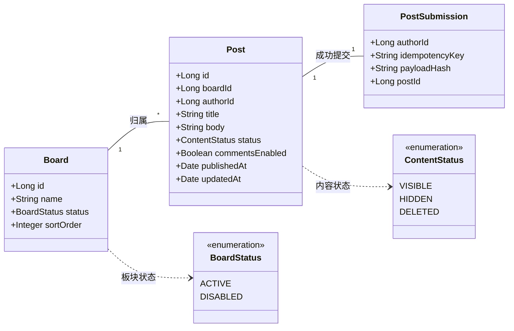
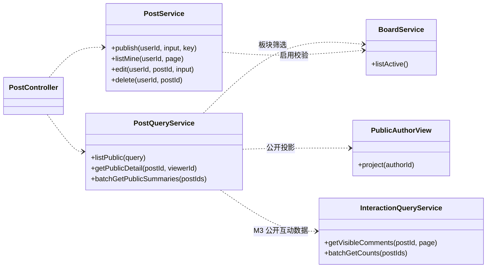
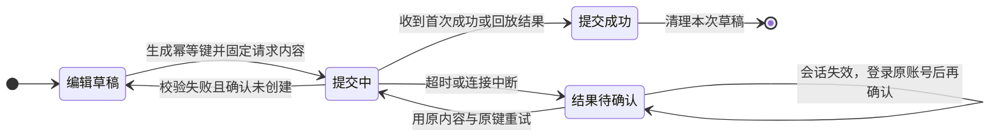

# M2 板块及帖子管理 设计初稿

> 版本：V1（组内评审稿）
>
> 范围：故事 1–3、15、25 的发帖部分、26、28–29，对应 FR-06 至 FR-12 和 NFR-04。
>
> 依据：[JYF 负责部分](jyf负责部分.md)、[校园社区 SRS](校园社区SRS初稿.docx)。
>
> 相关设计：[另一模块设计稿](M3-帖子互动-设计初稿.md)。Mermaid 源码随正文保存，PNG 集中存放于 [JYF-fig](JYF-fig/)。

## 0. 设计前提

| 编号 | 采用的口径 | 对接或确认事项 |
| --- | --- | --- |
| A1 | 公开列表、搜索和详情共用内容可见性判断。 | 与 M3 / M4 共用 VISIBLE、HIDDEN、DELETED。 |
| A2 | 按业务库分页查询标题或正文。 | 按 NFR-08 首屏测试评估索引。 |
| A3 | 发帖结果不明确时保留原请求内容与同一幂等键。 | 与 M1 约定会话失效后的草稿处理。 |
| A4 | 板块入口和新发帖选项只使用当前可用板块。 | 历史帖按项目统一的公开可见性规则处理。 |
| A5 | 公共摘要、公开详情与本人管理各有明确的响应字段。 | 公开字段使用项目统一白名单。 |
| A6 | 查询采用稳定排序。列表、搜索、详情直接读已提交的业务数据。 | 首版分页大小及搜索长度上限在联调确认。 |

## 1. 类图

### 1.1 M2 板块与帖子核心类图（FR-06～FR-12）

[查看 PNG 图例](<JYF-fig/M2-1.1-板块与帖子核心类图.png>)

- `PostSubmission` 按 `(authorId, idempotencyKey)` 唯一，`postId` 也唯一。成功发帖时两条记录同事务保存。
- 修改标题、正文或板块时保留帖子 ID、发布时间和互动关系。下架帖子不可借编辑恢复公开。作者删除帖子时保留关联记录，公开访问停止。

### 1.2 实体职责

| 实体 | 职责 |
| --- | --- |
| Board | 读取板块状态、名称和排序，供公开入口、筛选及发帖校验。 |
| Post | 保存帖子内容、作者、板块及公开状态，并提供作者管理操作。 |
| PostSubmission | 保存成功提交关联，支持按用户和键回放。 |

### 1.3 应用服务与查询边界

[查看 PNG 图例](<JYF-fig/M2-1.3-应用服务与查询边界.png>)

| 响应用途 | 允许的字段与范围 |
| --- | --- |
| 公开列表及搜索 | 帖子 ID、标题、板块、发布时间、公开作者标识和互动摘要。 |
| 公开详情 | 公开摘要加正文、可见评论及评论开关。有有效会话时仅查询查看者本人的点赞和收藏状态。 |
| 本人管理 | 本人帖子 ID、标题、板块、状态与发布时间。服务端按会话归属过滤。 |

## 2. 状态图

### 2.1 M2 发帖提交状态（FR-09、NFR-04）

[查看 PNG 图例](<JYF-fig/M2-2.1-发帖提交状态.png>)

### 2.2 作者删除与公开可见性（FR-07、FR-11、FR-12）

<!-- JYF review: M2-2.2-作者删除与公开可见性.png -->

公开查询只接受 VISIBLE。帖子处于 HIDDEN 或 DELETED 时，公开入口返回不可访问，编辑被拒绝。作者确认删除时改为 DELETED，同一作者重复删除沿用原结果。

未登录或归属不匹配的请求不发生状态变化。

## 3. 时序图

### 3.1 按板块浏览（FR-06）

<!-- JYF review: M2-3.1-按板块浏览.png -->

分页按发布时间和 ID 倒序。切换过程中，前端只使用当前选中板块对应的响应。

### 3.2 M2 发布与重试（FR-09、NFR-04）

<!-- JYF review: M2-3.2-发布与重试.png -->

幂等摘要按规范化的发帖请求内容计算。若唯一键冲突，回滚本次写入后按用户和键回查，再校验摘要。重试回放只返回原提交结果，失效帖子正文仍受公开详情权限限制。

### 3.3 我的帖子与删除（FR-10、FR-12）

<!-- JYF review: M2-3.3-我的帖子与删除.png -->

列表和删除接口均从有效会话取当前用户。删除提交后，公开列表、搜索、详情和新增互动使用更新后的状态。

### 3.4 关键词搜索与板块筛选（FR-08）

<!-- JYF review: M2-3.4-关键词搜索与板块筛选.png -->

关键词中的数据库通配符按字面字符处理。接口先约束分页及关键词长度，再查询业务库。编辑成功后查询使用新内容，删除或下架的帖子在重新搜索时退出结果集。

### 3.5 公开详情与评论读取（FR-07）

<!-- JYF review: M2-3.5-公开详情与评论读取.png -->

后续翻评论页时再次校验父帖状态。响应只包含允许公开的作者展示字段；失效时前端清除已加载的正文和评论。

### 3.6 编辑本人帖子（FR-11）

<!-- JYF review: M2-3.6-编辑本人帖子.png -->

仅按实际变化校验迁板，保留发布时间与原互动。作者权限和可编辑状态在写锁内复核，避免并发下架后被旧请求改回公开。

## 4. 跨模块接口约定

| 对接方 | 接口或口径 |
| --- | --- |
| M1 账号 | 从有效会话取得 userId，确认公开资料字段及退出账号时清理个人草稿的方式。 |
| M3 帖子互动 | M2 校验父帖可见性，详情组合 M3 的可见评论、评论开关与互动数据。 |
| M5 收藏（FR-23） | 提供帖子可见性检查和公开摘要，失效项不返回正文。 |

### 4.1 外部接口与错误处理

| 接口 | 主要输入 | 成功结果 | 失败口径 |
| --- | --- | --- | --- |
| `GET /boards` | 无 | 启用板块 | 无启用板块返回空集合 |
| `GET /posts` | `boardId`、`q`、分页 | 公开摘要页 | 参数非法 400，指定板块失效 404 |
| `GET /posts/{id}` | 帖子 ID、评论分页 | 公开详情 | 不存在、已下架或删除均为 404 |
| `GET /me/posts` | 分页 | 本人管理列表 | 会话失效 401 |
| `POST /posts` | 板块、标题、正文及幂等键 | 首次 201，同内容重放 200 | 400 输入非法，401 会话失效，403 发帖限制，409 板块停用或同键异内容 |
| `PATCH /posts/{id}` | 可编辑字段 | 200 更新摘要 | 400 字段不合法，401 会话失效，404 不存在或非本人，409 状态或板块不允许 |
| `DELETE /posts/{id}` | 帖子 ID | 204，重复删除结果一致 | 401 会话失效，404 不存在或非本人 |

### 4.2 事务与并发

| 场景 | 处理方式 | 可验证结果 |
| --- | --- | --- |
| 同键重复发帖 | 先按账号、键查询成功记录。写入帖子与幂等记录同事务提交，唯一冲突后回查。 | 同请求至多一条帖子，重试返回原 ID。 |
| 发布与板块停用 | 在关键写入前锁定同一板块。 | 停用先提交时，之后的发布被拒绝。 |
| 编辑迁板与下架 | 先锁目的板块，再锁帖子，写前复核作者及状态。 | 下架先提交时，之后的编辑被拒绝。 |
| 作者删除与新增互动 | 两个模块按同一父帖记录互斥。 | 删除先提交时，后到的点赞、收藏和评论被拒绝。 |

待评审事项为公开接口分页大小和首屏索引选型。当前方案可用同一应用和业务数据库实现。

## 5. 需求覆盖与绘图分工

| 用户故事 | SRS | 设计位置 | 验收重点 |
| --- | --- | --- | --- |
| 1 | FR-06 | §3.1 | 可用板块只显示对应可见帖，空板块显示空状态。 |
| 2 | FR-07 | §2.2、§3.5 | 详情显示标题、正文和可见评论，失效旧链接返回 404。 |
| 3 | FR-08 | §3.4 | 关键词、板块与可见性条件同时生效。 |
| 15 | FR-10 | §3.3 | 只显示本人帖子，按发布时间倒序并展示状态。 |
| 25 发帖部分 | NFR-04 | §1.1、§2.1、§3.2 | 模拟首次请求未送达、已保存但丢响应、同键并发和异载荷。 |
| 26 | FR-09 | §3.2 | 必填项、发帖权限和启用板块校验，发布成功后可浏览。 |
| 28 | FR-11 | §2.2、§3.6 | 编辑后公开查询同步并保留互动，下架帖不能复活。 |
| 29 | FR-12 | §2.2、§3.3 | 删除后公开入口失效，新增互动被拒绝。 |

JYF 负责本文的用户侧 M2 图例。
