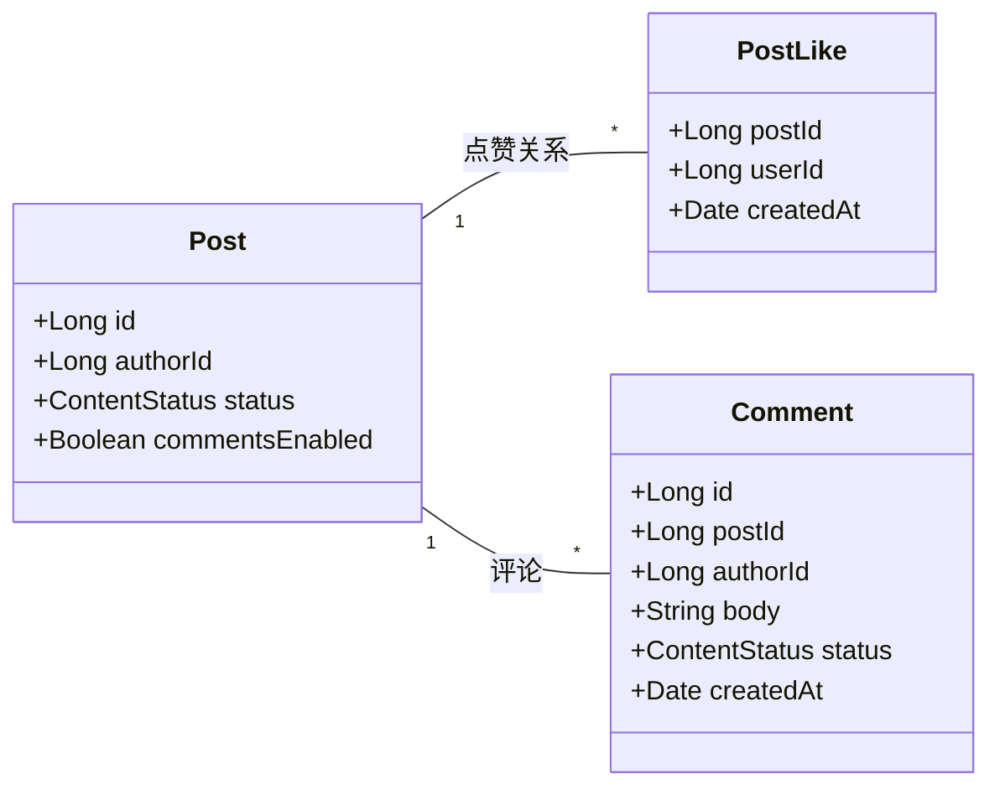
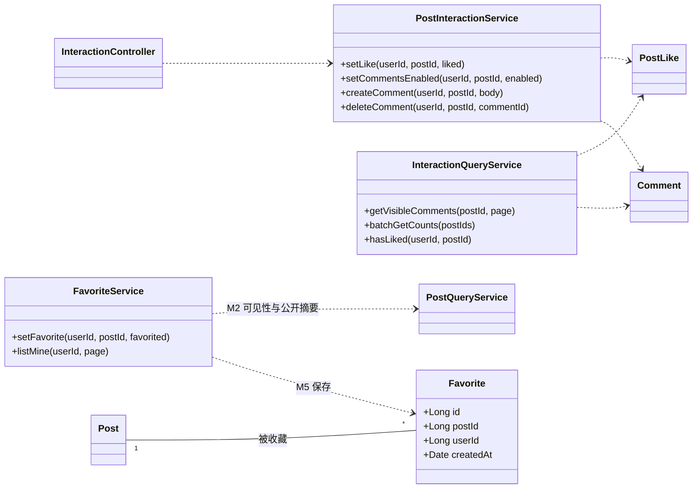
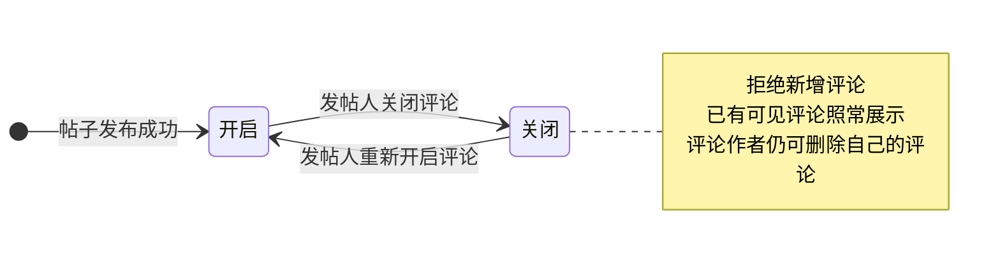
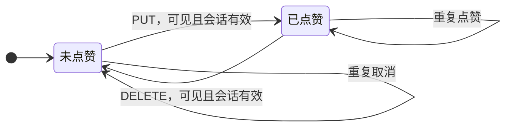
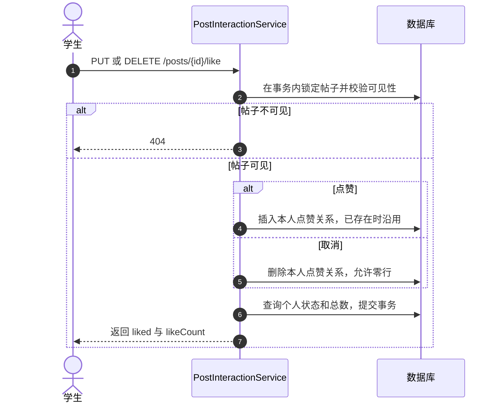
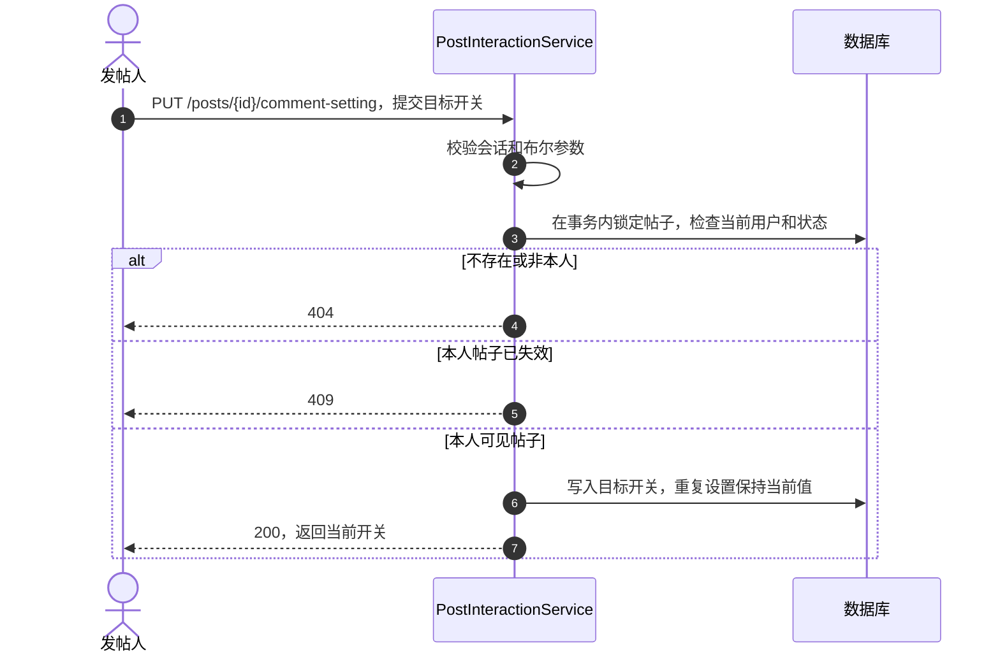

# M3 帖子互动 设计初稿

> 版本：V1（组内评审稿）
>
> 范围：故事 5、7、27、30–31，对应 FR-13 至 FR-16 和收藏 FR-23。
>
> 依据：[JYF 负责部分](jyf负责部分.md)、[校园社区 SRS](校园社区SRS初稿.docx)。
>
> 相关设计：[另一模块设计稿](M2-板块及帖子管理-设计初稿.md)。Mermaid 图例随正文保存。

## 0. 设计前提

| 编号 | 采用的口径 | 对接或确认事项 |
| --- | --- | --- |
| A1 | 点赞数按关系记录统计，评论数按可见评论统计。 | M2 详情读取同一业务库，查询只计入可见评论。 |
| A2 | 关评、发新评论和删除使用同一父帖锁。 | 涉及单条评论时先锁父帖，再锁评论。 |
| A3 | 收藏失效后保留可移除的占位，正文不公开。 | 占位样式与 M5 确认。 |
| A4 | 点赞与收藏采用设置目标状态的接口，请求重复时状态稳定。 | 前端按同一帖子的操作顺序更新状态。 |
| A5 | 新增评论需要评论权限，撤回本人评论按归属判断。 | 已有评论继续按可见状态展示。 |

## 1. 类图

### 1.1 M3 点赞与评论类图（FR-13～FR-16）

`PostLike` 按 `(postId, userId)` 唯一。点赞数按关系记录统计，评论数仅统计 `VISIBLE` 评论，列表按页批量取数。父帖不可访问时公开接口不返回其评论与互动计数。

### 1.2 实体职责

| 实体 | 模块 | 职责 |
| --- | --- | --- |
| PostLike | M3 | 保存每个账号对一个帖子的唯一点赞关系。 |
| Comment | M3 | 保存评论与可见状态，作者可撤回本人评论。 |
| Favorite | M5 | 保存本人收藏关系，M2 提供公开摘要和可见性校验。 |

### 1.3 互动服务与收藏对接类图

| 数据约束 | 查询或写入规则 |
| --- | --- |
| 点赞 | `(postId, userId)` 唯一。按帖取总数，按帖及当前用户取个人状态。 |
| 评论 | 父帖与评论均需可见才允许公开读取。父帖的评论按 `createdAt` 与 `id` 稳定分页。 |
| 收藏 | `(postId, userId)` 唯一。本人列表按收藏时间和 ID 倒序，批量组合可公开的帖子摘要。 |

## 2. 状态图

### 2.1 M3 评论开关状态（FR-15）

新增评论同时要求帖子可见、开关开启、账号有评论权限以及正文非空。关评和发表评论锁定同一帖子，并发请求按事务顺序生效。

### 2.2 作者删除与评论可见性（FR-14、FR-16）

发表评论后为 VISIBLE。公开读取要求父帖与评论均可见，关闭评论不改变已有评论状态。作者撤回本人的评论后标记为 DELETED，并刷新可见评论数。

### 2.3 点赞关系状态（FR-13）

帖子的公开可见性独立于关系状态。若目标已下架或删除，公开接口拒绝点赞操作及数据读取，关系记录继续保留。

## 3. 时序图

### 3.1 M3 点赞与取消点赞（FR-13）

### 3.2 设置帖子评论开关（FR-15）

关评只影响新增评论；已有可见评论照常展示。重新开启时，仍由评论接口验证会话、权限与帖子状态。

### 3.3 收藏、取消与查看（FR-23，跨 M5）

<!-- diagram-m3-07 -->

M5 维护收藏关系，M2 提供帖子可见性检查和公开摘要。失效项隐藏正文，保留本人取消收藏的入口。

### 3.4 发表评论（FR-14）

<!-- diagram-m3-08 -->

正文为空返回 400，失效会话返回 401。同一帖子的关评、删除和新增评论在父帖锁下排序。

### 3.5 删除本人评论（FR-16）

<!-- diagram-m3-09 -->

关评期间仍可删除本人评论。已经隐藏的评论不计入公开数量，后续撤回不再减少一次。父帖失效时仍可撤回，但响应不返回正文或计数。

## 4. 跨模块接口约定

| 对接方 | 接口或口径 |
| --- | --- |
| M1 账号 | 从有效会话取得用户 ID，校验当前用户的评论归属及个人互动关系。 |
| M2 板块及帖子管理 | M2 提供父帖状态、作者与可见性检查，详情读取 M3 提供的可见评论和互动数据。 |
| M5 收藏（FR-23） | M5 维护收藏关系，M2 提供帖子公开摘要，失效项隐藏正文并允许取消收藏。 |

### 4.1 外部接口与错误处理

| 接口 | 请求或操作 | 成功结果 | 失败口径 |
| --- | --- | --- | --- |
| `PUT /posts/{id}/like` / `DELETE /posts/{id}/like` | 设置或移除本人点赞 | 200，`liked`、`likeCount` | 401 会话失效，404 父帖不可访问 |
| `PUT /posts/{id}/comment-setting` | `commentsEnabled` | 200，当前开关 | 400 布尔参数无效，401 会话失效，404 非本人或不存在，409 本人帖已失效 |
| `POST /posts/{id}/comments` | `body` | 201，新评论、`commentCount` | 400 空正文，401 会话失效，403 账号受限，404 父帖不可访问，409 关闭评论 |
| `DELETE /posts/{postId}/comments/{commentId}` | 帖子与评论 ID | 父帖可见时 200 及计数，否则 204 | 401 会话失效，404 不存在、非本人或父帖不匹配 |
| `PUT /posts/{id}/favorite` / `DELETE /posts/{id}/favorite` | 创建或移除本人关系 | 200，个人收藏状态 | 401 会话失效，新增时父帖不可见为 404 |
| `GET /me/favorites` | 分页 | 本人收藏页，可含失效占位 | 401 会话失效 |

### 4.2 并发与重试

| 场景 | 处理方式 | 可验证结果 |
| --- | --- | --- |
| 同账号重复点赞或收藏 | 唯一关系约束与目标状态接口配合。 | 两次并发新增只保留一条；重复取消成功。 |
| 关闭评论和同时发布评论 | 两个写接口锁定同一父帖，再检查开关。 | 关评先提交则后到评论被拒绝，旧评论仍可读。 |
| 作者重复删除评论 | 先锁父帖再锁评论，重复请求沿用 DELETED。 | 可见数量只变化一次。 |
| 删除帖子和同时新增互动 | 新增互动在事务中与作者删除共用同一父帖锁。 | 帖子失效后到达的新写入被拒绝。 |

首版使用数据库唯一约束、事务和按页聚合即可实现点赞、评论和收藏。优先联调可见性规则，再确认失效收藏的占位效果。

## 5. 需求覆盖与绘图分工

| 用户故事 | SRS | 设计位置 | 验收重点 |
| --- | --- | --- | --- |
| 5 | FR-13 | §1.1、§3.1 | 同一账号重复点赞只计一次，取消后刷新一致。 |
| 7 | FR-23 | §3.3、§4 | 本人收藏可持久化，失效帖无正文且可移除。 |
| 27 | FR-15 | §2.1、§3.2 | 作者可关评及重新开启，关评期间历史评论仍可读。 |
| 30 | FR-14 | §2.1、§3.4 | 拒绝空评论、权限不足及关评时的新增请求。 |
| 31 | FR-16 | §2.2、§3.5 | 关评仍可删除本人评论，公开评论数同步。 |

JYF 负责本文的 M3 图例和故事 7 的收藏流程，收藏数据接口与 M5 负责人确认。
