# M4 举报与社区治理 设计初稿

> 版本：V2（根据设计评审意见修订）
>
> 范围：M4 本体 FR-17 / FR-18 / FR-19 / FR-20 / FR-22 与 NFR-06；交叉项 FR-21（M2）、FR-24 / FR-25（M5）、FR-29（M6）、NFR-02 / NFR-05。
>
> 用途：作为个人绘图初稿，可直接用 Mermaid 渲染，也可对照在 ProcessOn / draw.io 中重绘。
>
> 约定：实线 `--` 表示关联，虚线 `..>` 表示依赖；图中涉及未确认口径的位置均标注“待确认”。

## 0. 设计前提（需组内确认）

| 编号 | 采用的口径 | 影响方 |
| --- | --- | --- |
| A1 | 举报状态为 `PENDING / UPHELD / REJECTED` 三态 | M4 |
| A2 | 帖子与评论共用内容状态 `VISIBLE / HIDDEN / DELETED`；帖子的“下架”和评论的“隐藏”统一记为 `HIDDEN` | M2 / M3 |
| A3 | FR-19 只做内容处置（下架 / 隐藏 / 无违规），账号限制走 FR-20 独立接口 | M4 |
| A4 | 下架 / 隐藏本期不支持撤销恢复，只保留状态与记录 | M2 / M3 / M4 |
| A5 | 账号限制到期采用“查询时惰性判定并持久化为 `EXPIRED` + 定时清理”，`endAt` 为空表示永久限制 | M4 |
| A6 | FR-19 结案通知依赖 M6，未接入时举报人仍可通过 FR-18 查询；FR-20 告知为必做，采用当前限制查询兜底，并尽量发送 M6 通知 | M4 / M6 |
| A7 | 匿名追溯只返回核查所需的最小账号信息，具体字段待 TBD-01；审计只记返回字段名，不记敏感字段值 | M4 / M5 |
| A8 | 禁止举报自己；`VISIBLE` 与 `HIDDEN` 内容可举报，`DELETED` 内容不接受新举报；结案后允许再次举报并生成新记录 | M4 |
| A9 | 举报人身份仅授权管理员在核查接口可见；公共接口和举报人本人接口均不返回其他用户信息 | M4 |
| A10 | 同一用户同一限制类型最多一条 `ACTIVE`；同时限制发帖和评论使用两条记录；调整期限或范围采用“解除旧记录 + 新建记录” | M4 |
| A11 | 下架 / 隐藏通过 M2 / M3 提供的领域服务完成，M4 不直接修改内容表；FR-11 由 M2 保证 | M2 / M3 / M4 |
| A12 | 管理权限默认每次请求实时查询；若后续使用缓存，权限变更必须主动失效相关缓存 | 全组 |
| A13 | 举报处置映射固定：不成立=`NONE`；成立未下架=`VIOLATION_CONFIRMED`；成立且下架 / 隐藏=`CONTENT_REMOVED`，状态与动作必须一致 | M4 |

## 1. 类图

### 1.1 社区治理核心类图

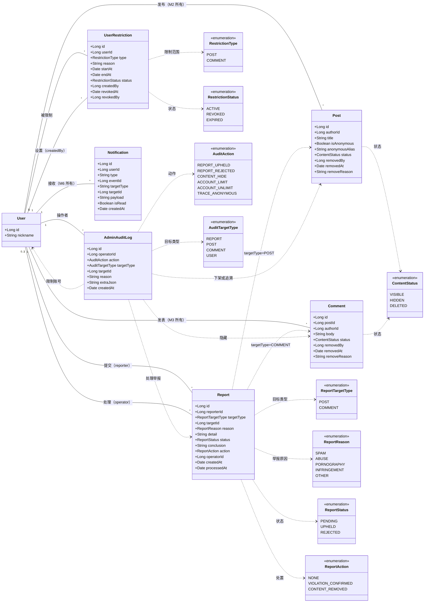

### 1.2 权限支撑类图（全组共用）

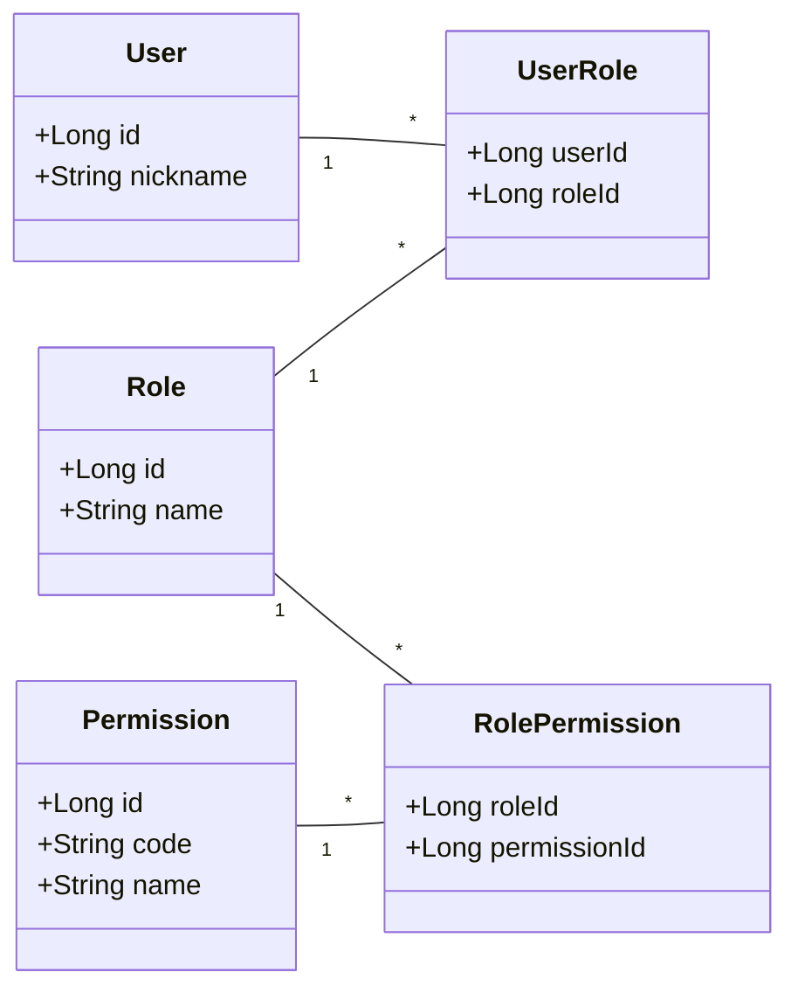

M4 权限点初稿：`report:handle`、`account:limit`、`anonymous:trace`。板块维护、纠纷处理、审计查看等权限点由对应模块共同确认。

### 1.3 实体职责说明

| 实体 | 归属 | 说明 |
| --- | --- | --- |
| `Report` | M4 | 一条举报只指向一个帖子或一条评论；同一举报人对同一目标最多一条 `PENDING` |
| `ReportReason` | M4 | 固定原因类别；选择 `OTHER` 时 `detail` 必填，其余原因可选填说明 |
| `ReportAction` | M4 | `NONE` 仅用于举报不成立；`VIOLATION_CONFIRMED` 表示成立但未下架；`CONTENT_REMOVED` 表示成立且已下架 / 隐藏 |
| `UserRestriction` | M4 | 同一用户同一类型最多一条 `ACTIVE`；只有当前时间在有效区间内才实际生效 |
| `AdminAuditLog` | M4 | 只允许插入；记录操作者、时间、目标、动作、理由；`extraJson` 禁止保存学号、手机号等敏感字段值 |
| `Post` / `Comment` | M2 / M3 | M4 只读取作者与状态；下架 / 隐藏及 `removedBy / removedAt / removeReason` 由 M2 / M3 领域服务写入 |
| `Notification` | M6 | M4 产生“账号限制 / 账号恢复 / 举报结案”事件；账号限制理由另有查询接口兜底 |
| `Role` / `Permission` | 全组 | 保留角色—权限点模型；M4 出权限点初稿，所有管理接口共用 |

匿名追溯不再单独维护 `AnonymousTraceLog`，统一使用 `AdminAuditLog(TRACE_ANONYMOUS)`；`extraJson` 仅记录 `postId`、追溯理由、返回字段名等审计元数据。

## 2. 状态图

### 2.1 举报状态

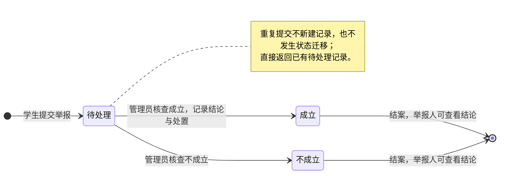

规则：

- 同一举报人对同一目标只允许一条 `PENDING`；采用数据库唯一约束，并处理并发唯一键冲突后回查已有记录。
- `UPHELD` / `REJECTED` 为终态；再次举报生成新记录，不复用旧记录。
- `VISIBLE`、`HIDDEN` 内容可举报；`DELETED` 内容保留历史举报，但不接受新举报。

### 2.2 账号限制状态

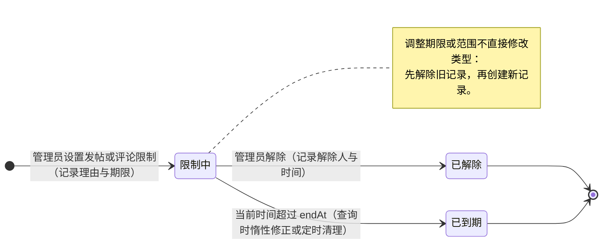

规则：

- 生效条件：`status=ACTIVE` 且 `now >= startAt` 且（`endAt` 为空或 `now < endAt`）。
- 同一用户同一类型最多一条 `ACTIVE`；同时限制发帖和评论使用两条记录。
- 到期不依赖管理员操作，发帖 / 评论校验或用户查询限制时惰性判定，并将记录更新为 `EXPIRED`；定时任务兜底。
- 设置和解除必须与审计写入处于同一事务。

### 2.3 内容可见状态（与 M2 / M3 共管）

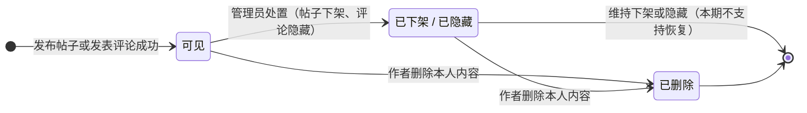

规则：

- 帖子“下架”和评论“隐藏”共用 `HIDDEN`，在业务文案上区分。
- 普通用户的列表、搜索、详情、旧链接统一只返回 `VISIBLE`，由 M2 / M3 的查询层落实。
- 编辑帖子不得把 `HIDDEN` 恢复为 `VISIBLE`（FR-11，由 M2 保证）。
- 评论隐藏后，`commentCount` 只统计 `VISIBLE` 评论，由 M3 同步更新或重算。

## 3. 时序图

### 3.1 提交举报（FR-17）

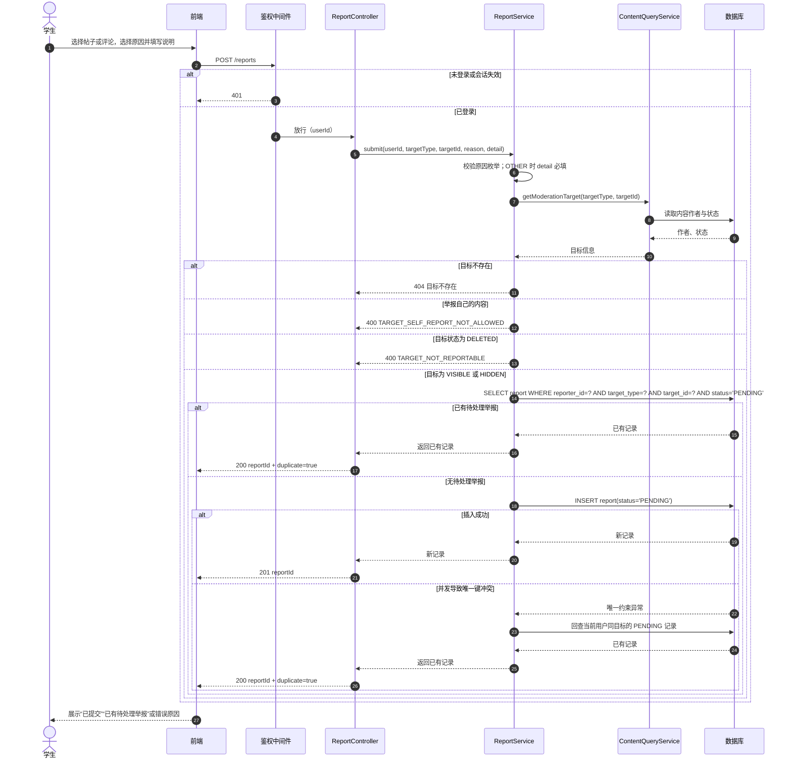

要点：

- 预查与唯一约束共同防重；唯一约束的实现方式随数据库选型确定，不能仅依赖预查。
- 普通响应不包含其他用户身份；管理核查接口才按权限返回举报人必要标识。
- `getModerationTarget` 是管理核查专用只读接口，可读取 `HIDDEN` 内容供复核举报，但不向普通用户开放内容正文；目标不存在或当前用户无权访问时统一返回 404。`DELETED` 内容不能新建举报。

### 3.2 查看本人举报及处理结果（FR-18）

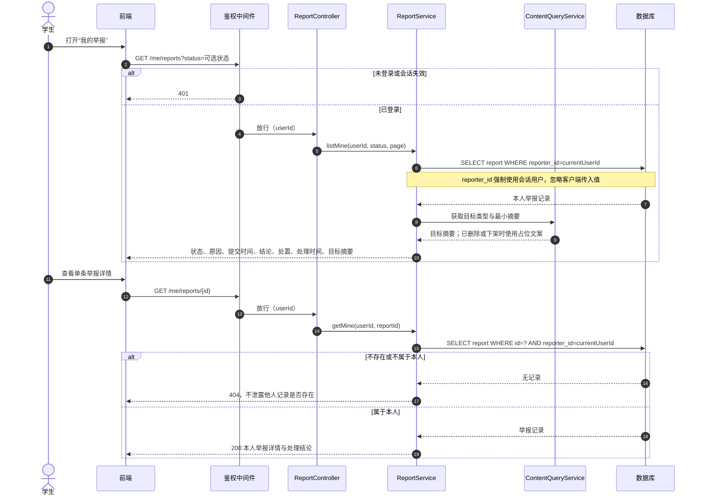

要点：

- 待处理记录返回 `PENDING`；结案记录返回结论与处置结果，无需等待通知即可验收 FR-18。
- 响应不包含其他举报人信息；目标摘要按最小必要原则返回，已删除或下架内容使用统一占位文案。
- 管理接口不能复用本人查询条件；本人接口也不接受客户端指定 `reporterId`。

### 3.3 处理举报并下架内容（FR-19）

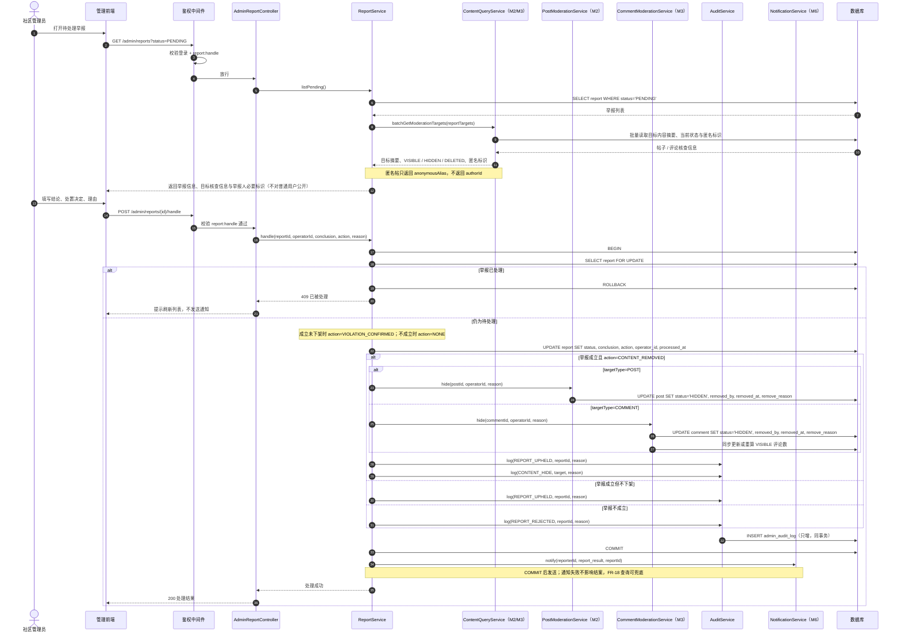

要点：

- 更新举报、调用内容领域服务、写审计处于同一事务边界；任何一步失败均回滚，不发送通知。
- M4 不直接修改 `post / comment` 表；M2 / M3 负责内容状态及处置字段写入。
- `FOR UPDATE` 防并发重复处理；仅成功结案才发送通知。
- 列表通过 M2 / M3 只读接口补齐目标摘要、当前可见状态与匿名标识，满足 FR-19 的核查取数要求。
- 成立且下架使用 `CONTENT_REMOVED`，成立但未下架使用 `VIOLATION_CONFIRMED`，不成立使用 `NONE`，FR-18 可据此返回明确处置结果。
- 成立且下架写 `REPORT_UPHELD + CONTENT_HIDE` 两条审计；不成立只写 `REPORT_REJECTED`。

### 3.4 限制与恢复账号、查看限制理由（FR-20）

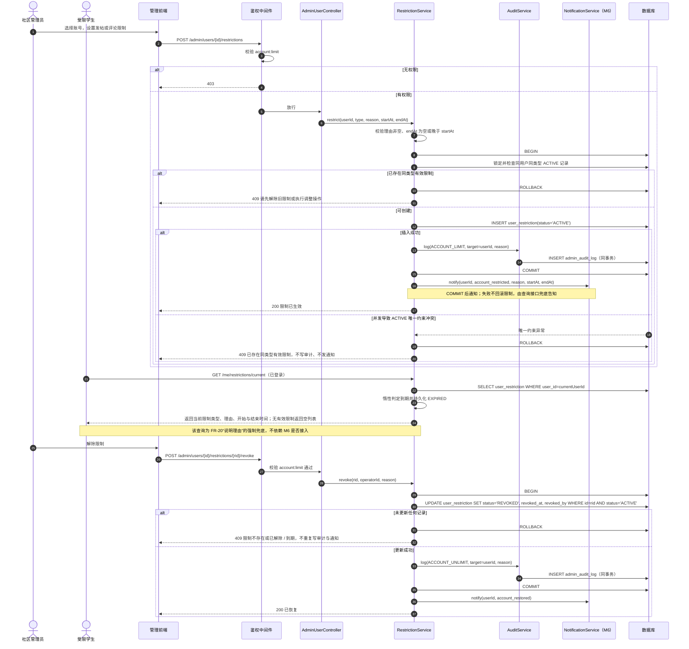

要点：

- 限制、解除与审计写入必须同事务；通知只在 `COMMIT` 后发送。
- 受限用户始终可通过 `GET /me/restrictions/current` 查看理由；M6 通知是补充通道，不是唯一告知方式。
- 发帖 / 评论接口提交时查询有效限制，命中则拒绝并返回限制理由与期限。
- 同时限制发帖和评论创建两条记录；调整期限或范围时先解除旧记录，再创建新记录。

### 3.5 匿名追溯（FR-25，跨 M5）

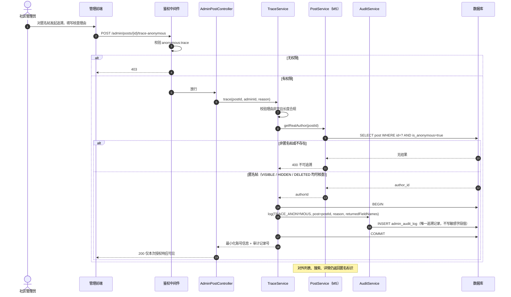

要点：

- 普通接口永不返回 `authorId`；追溯结果只出现在本次管理响应中，帖子对外仍是匿名。
- 已隐藏或已删除的匿名帖仍可按管理核查需要追溯。
- 只写一条 `AdminAuditLog(TRACE_ANONYMOUS)`；`extraJson` 记录返回字段名，不记录敏感字段值。

### 3.6 管理接口统一鉴权（FR-22 / NFR-02）

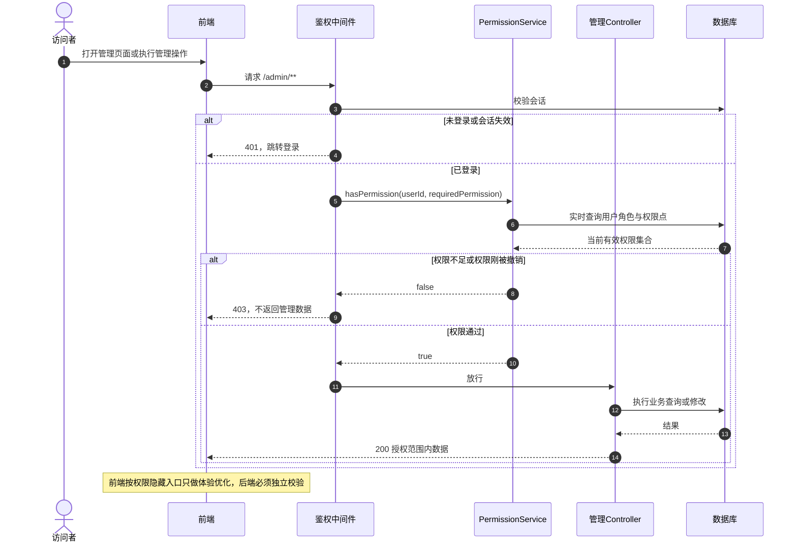

要点：

- 权限点按路由声明；对象级权限（资源归属）在 Service 层二次校验。
- 默认不使用权限缓存；若后续引入，权限变更时必须主动失效相关用户缓存，不能只依赖 TTL。
- 拒绝对外不泄露管理数据。

## 4. 跨模块接口约定

| 对接方 | 需要对方确认或提供 | M4 提供 |
| --- | --- | --- |
| M2 板块与帖子(组员JYF负责) | 帖子只读查询：`getModerationTarget(POST, id)`、批量目标摘要 / 状态 / 匿名标识查询；`PostModerationService.hide(postId, operatorId, reason)`；统一下架过滤；保证 FR-11 编辑不能复活下架帖；FR-21 板块维护流程由 M2 主责 | 举报处理调用、`report:handle` 权限校验、审计写入；配合板块管理权限和审计 |
| M3 帖子互动(组员JYF负责) | 评论只读查询：`getModerationTarget(COMMENT, id)`、批量目标摘要 / 状态查询；`CommentModerationService.hide(commentId, operatorId, reason)`；隐藏后 `commentCount` 只统计 `VISIBLE` 评论 | 举报处理调用、管理员隐藏入口、审计写入 |
| M5 匿名交流（组员CF负责） | `PostService.getRealAuthor(postId)`；`is_anonymous / author_id` 字段；追溯返回字段范围 | `anonymous:trace` 权限、`TRACE_ANONYMOUS` 审计、最小化返回约束 |
| M6 私信与通知（组员CF负责） | `notify()` 接口及 `account_restricted / account_restored / report_result` 类型 | 仅在事务成功后产生事件及载荷；限制理由通过 `/me/restrictions/current` 独立兜底 |
| 全组 | RBAC 权限点清单、NFR-02 / 05 / 06 验收口径 | 权限点初稿、审计写入 API；NFR-05 涉及 `report / user_restriction / admin_audit_log` 表的备份与恢复核对 |

模块可以位于同一应用内，不要求拆成微服务；上述 Service 表示明确的模块接口和读写责任边界。`ContentQueryService` 是 M4 侧的查询门面，帖子数据由 M2 提供、评论数据由 M3 提供，不要求另建共享服务。

待组内确认项：M3 选择同步扣减还是重算评论数（处理结果返回前必须一致）；`HIDDEN` 内容的举报入口保留在管理核查链路，不向普通用户额外开放正文；用例图中 FR-21 的包归属与 SRS 模块分工统一。

## 5. 需求覆盖与绘图分工

| 需求 | 设计覆盖位置 |
| --- | --- |
| FR-17 举报帖子 / 评论 | §1.1 `Report / ReportReason`、§2.1、§3.1 |
| FR-18 查看举报处理结果 | §3.2；本人列表与详情、归属强制校验、处理结论返回 |
| FR-19 处理举报与违规内容 | §1.1、§2.1 / §2.3、§3.3；事务、内容领域服务、审计与结案通知 |
| FR-20 限制与恢复账号 | §1.1 `UserRestriction`、§2.2、§3.4；限制理由查询为强制兜底 |
| FR-22 授权范围内管理 | §1.2、§3.6；实时权限校验 |
| NFR-06 管理操作可追溯 | §1.1 `AdminAuditLog`、§3.3 / §3.4 / §3.5 |
| FR-25 匿名追溯（交叉） | §3.5；审计合并、最小化返回 |
| NFR-02 / NFR-05（交叉） | §3.6、§4 |

绘图与分工备注：

- 共享实体不要重复定义：`User / Role / Permission / Board / Post / Comment` 由对应负责人维护，M4 只引用必要字段。
- 共享图需共同署名：内容可见状态图（M2 / M3）、匿名追溯时序图（M5）、权限支撑类图（全组）。
- FR-21 以 SRS 模块编号为准，由 M2 主责；用例图的包归属建议在组内统一说明。
- 命名保持一致：举报状态 `PENDING / UPHELD / REJECTED`，内容状态 `VISIBLE / HIDDEN / DELETED`。
